# AdPilot AI

**The AI marketing team for Indian D2C brands and SMEs.**
AdPilot AI learns a brand once, then plans, creates, launches and improves its campaigns, and every claim it makes is grounded in the brand's own product facts.

> **Status:** end-to-end and running on the live API. Website → Brand Memory → strategy → 5 claim-checked ad concepts (English / Hindi / Hinglish) → real 15-second MP4 → approval and export → labelled metrics → ranking with confidence intervals → 4 next variants → **social posts for LinkedIn, Instagram and X** → **scheduling and manual publishing with posting-time intelligence** → everything learned is written to **Meko** shared memory, one datapack per brand. Gemini live with fallbacks and an offline generator. 49 automated tests pass.

### What it does, in one minute
1. **Learns a brand** from its website (or manual facts): products, tone, approved claims with their source, and the claims it must *not* make.
2. **Plans and creates**: a strategy, five distinct ad concepts and a real MP4 video ad, plus ready-to-post LinkedIn, Instagram and X content.
3. **Launches honestly**: you approve, schedule and export. AdPilot suggests the best time to post and opens the platform with your text filled in. It never posts or spends money by itself.
4. **Measures and learns**: results (simulated, CSV or entered by hand, always labelled) feed a ranking with confidence intervals, new variants and a posting-time model. What it learns is stored in Meko and used for the next campaign.

### Progress at a glance
| Area | State |
|---|---|
| Website extraction (JSON-LD, Open Graph, Shopify feed, SSRF guard, hidden-text stripping) | ✅ Done |
| Brand Memory (claim grounding, audience hypotheses, unknowns, brand colours) | ✅ Done |
| Strategist (6 objectives) · Ad generator (5 concepts) · Claim guard · Platform copy | ✅ Done |
| **Social posts** (LinkedIn, Instagram, X + thread; English / Hinglish / Hindi; claim-checked; **top 5 tags per platform**; edit, approve) | ✅ Done |
| **Scheduling and manual publishing** (best-time suggestion, share-intent links, record results) | ✅ Done |
| **Posting intelligence** (best day/time per platform, what content works, learned from past posts) | ✅ Done |
| **Connected social accounts** (link X / LinkedIn / Instagram handles per brand) | ✅ Done (link only, no OAuth) |
| **Meko shared memory** (datapack per brand: facts, learnings, posting patterns, recall) | ✅ Live |
| **Demo history** for 3 brands, 8 weeks, clearly labelled synthetic (`seed_history`) | ✅ Done |
| MP4 video ad renderer (5 styles, 9:16 / 1:1 / 4:5) + export ZIP + optional Pro AI-clip mode | ✅ Done |
| Metrics (simulated + CSV), Wilson intervals, P(best), next-variant optimization | ✅ Done |
| AI provider chain (Gemini → Groq / OpenRouter / Mistral / Cerebras / Ollama → offline) | ✅ Done |
| Restart recovery, SQLite auto-migration, JSON 500s with CORS | ✅ Done |
| Real posting through X / LinkedIn / Instagram APIs, real ad-platform connectors | 🟡 Designed, not connected |

### Screenshots
Captured from the running app. The brand is the fictional *Velvaa Skin* (offline generator). The posting history shown is **synthetic demo data and is labelled that way in the app**.

| | |
|---|---|
| 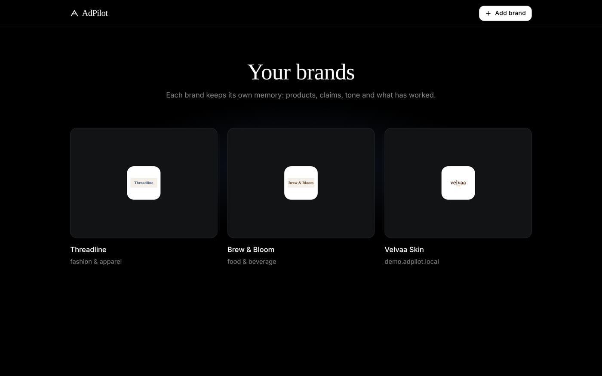 **Home:** three demo brands, each with its own memory | 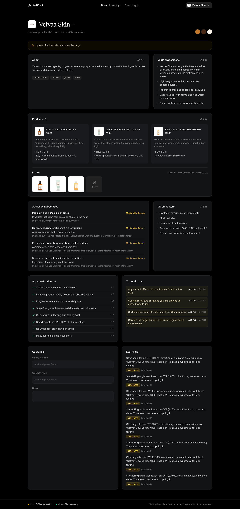 **Brand Memory:** profile, products, approved claims, warnings |
| 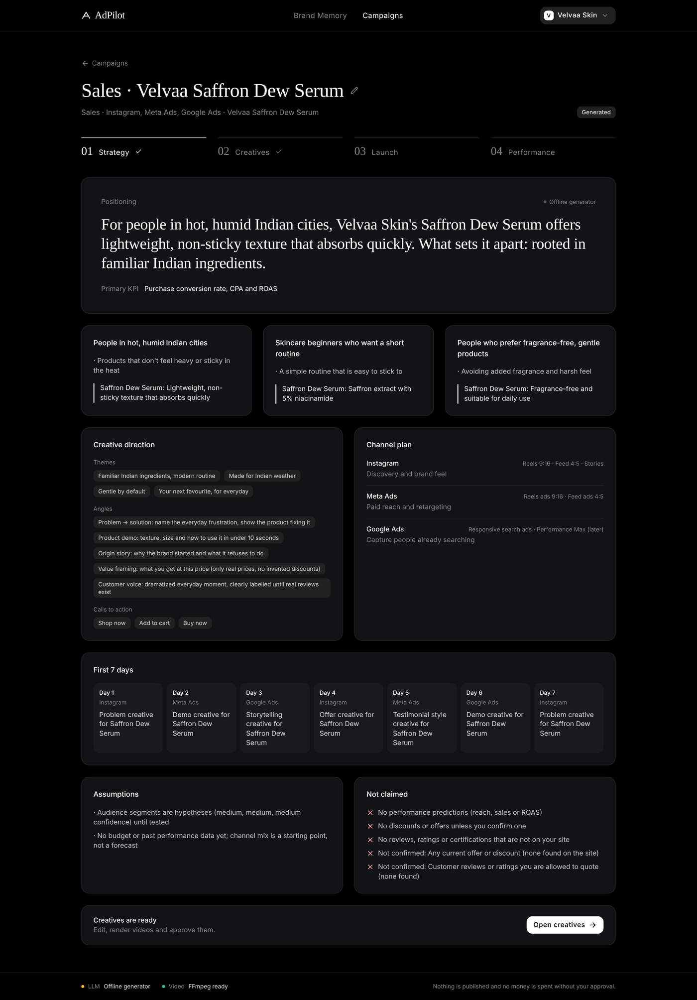 **Strategy:** segments, channel plan, 7-day calendar, "Not claimed" | 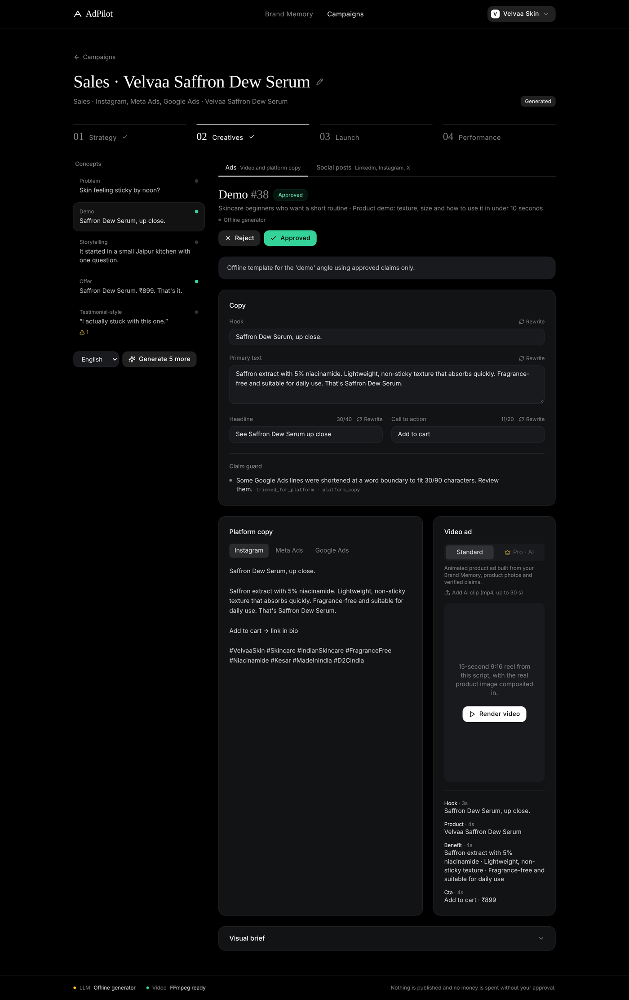 **Creatives › Ads:** editable copy, claim guard, video, approve / reject |
| 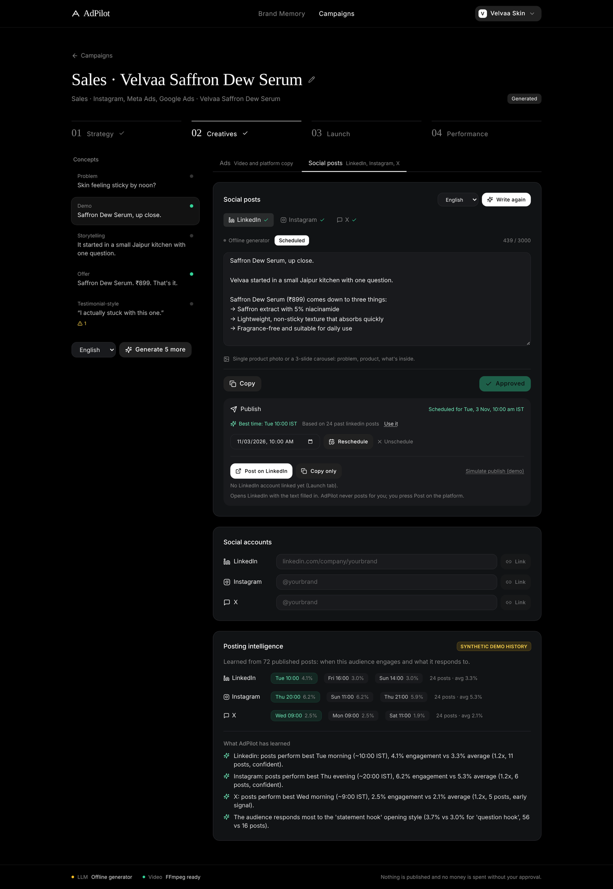 **Creatives › Social posts:** LinkedIn / Instagram / X, best-time suggestion, schedule, post | 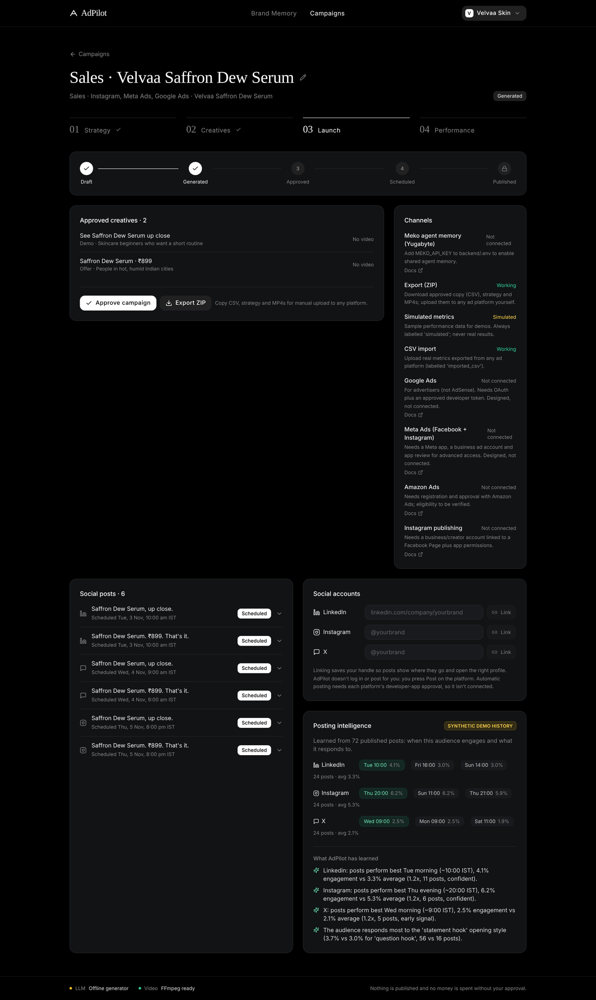 **Launch:** approved creatives, export, publishing hub, linked accounts |
| 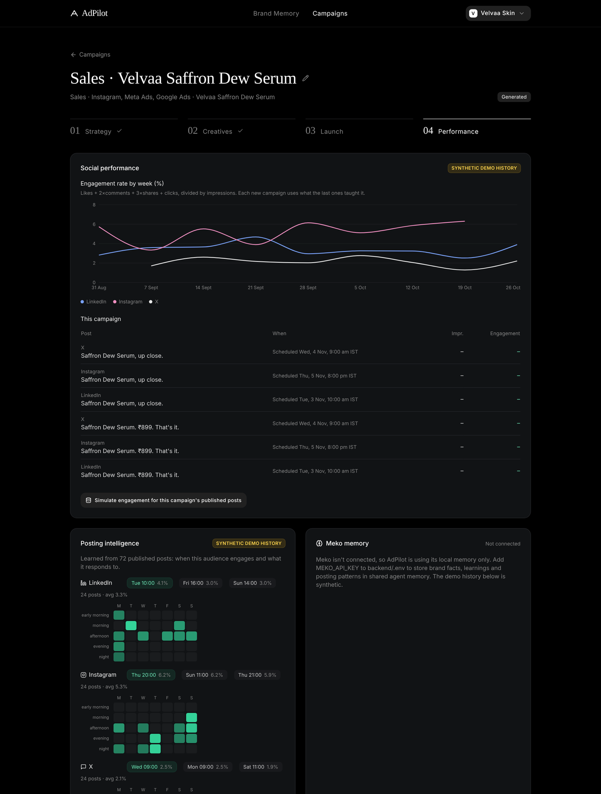 **Performance:** social learning curve, learned posting times, ad results | |

**The generated videos:** one row per concept type (problem, demo, storytelling, offer, customer-voice). Each type has its own look, the real product photo is on screen from the first seconds, and every scene keeps moving (drifting light, floating product, shine sweep, pop-in text, progress bar). Rendered by Python and FFmpeg from the brand's own product images; if the site has no usable photo the video uses a clearly plain brand tile (never a fake product drawing) and the API flags `needs_product_image`:

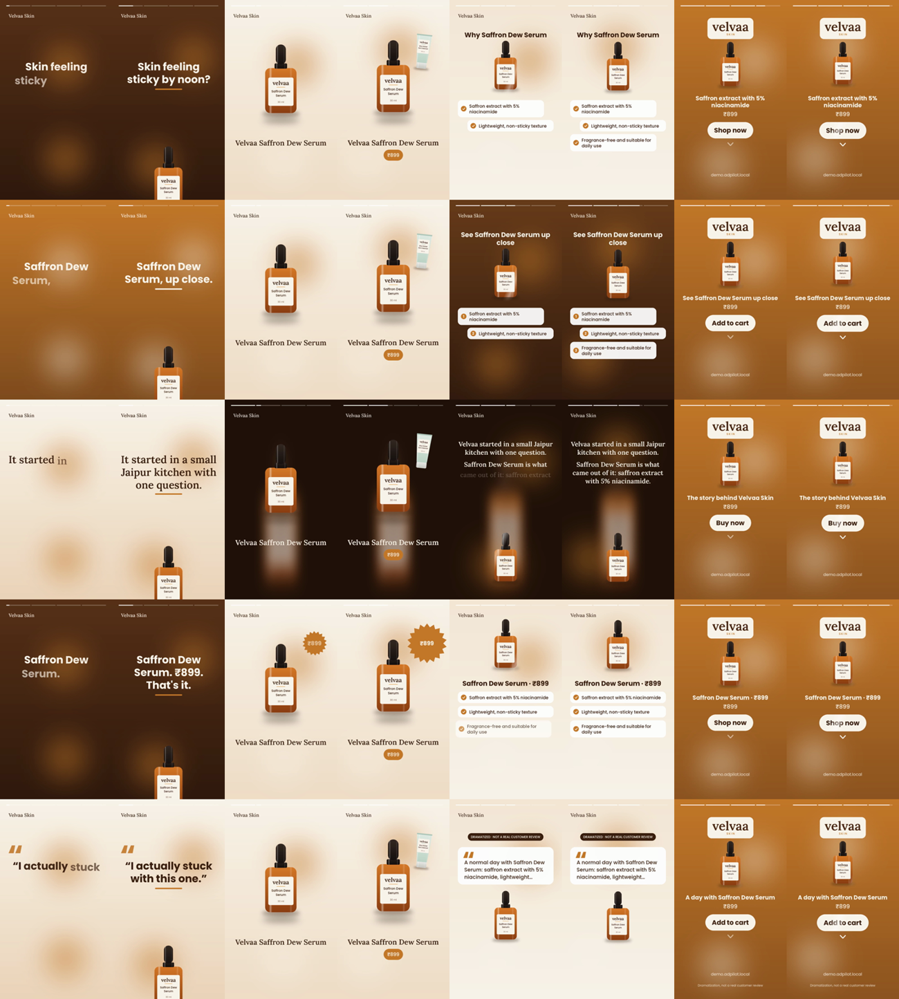

---

## Table of contents
1. [Product vision](#1-product-vision)
2. [Who it's for](#2-who-its-for)
3. [The ecosystem: 8 modules](#3-the-ecosystem-8-modules)
4. [What the MVP actually ships](#4-what-the-mvp-actually-ships)
5. [System architecture](#5-system-architecture)
6. [Data model](#6-data-model)
7. [End-to-end workflow](#7-end-to-end-workflow)
8. [Video generation design](#8-video-generation-design)
9. [Optimization engine design](#9-optimization-engine-design)
10. [Trust, safety and honesty rules](#10-trust-safety-and-honesty-rules)
11. [Ad platform integrations](#11-ad-platform-integrations)
12. [Tech stack](#12-tech-stack)
13. [Repository layout](#13-repository-layout)
14. [API overview](#14-api-overview)
15. [Demo script (≈4 minutes)](#15-demo-script-4-minutes)
16. [Risks and mitigations](#16-risks-and-mitigations)
17. [Long-term roadmap](#17-long-term-roadmap)
18. [Getting started](#18-getting-started)
19. [Reliability and extra features](#19-reliability-and-extra-features)
20. [Honest limits](#20-honest-limits)

---

## 1. Product vision

We are **not** building another AI ad generator. We are building a unified marketing ecosystem: one platform, one brand intelligence layer, many marketing capabilities, and a continuous feedback loop.

It brings the strategist, creative agency, copywriter, video editor, campaign manager and analyst into one workspace that shares the same memory of the brand.

```
            ┌──────────────────────────────────────────────┐
            │                BRAND MEMORY                  │
            │  products · audience · tone · visual identity │
            │  approved claims · claims to avoid · learnings│
            └───────▲───────────────┬──────────────────────┘
                    │ learnings     │ context for every generation
   ┌────────────────┴─┐  ┌──────────▼──────┐  ┌────────────────┐  ┌──────────────┐
   │ 8. Optimization  │◄─┤ 7. Analytics    │◄─┤ 5. Campaign    │◄─┤ 4. Creative  │
   │    Engine        │  │                 │  │    Manager     │  │    Studio    │
   └──────────────────┘  └─────────────────┘  └────────────────┘  └──────▲───────┘
                                                                         │
                         1. Brand Intelligence → 2. Market Intel → 3. Strategist
```

The loop is the product: **understand → plan → create → launch → measure → learn → create better.**

### Positioning statement
> For Indian D2C brands and SMEs that can't afford an agency, AdPilot AI is an AI marketing workspace that turns a website URL into a brand memory, campaign strategy, ready-to-post video ads and copy, and then learns from campaign results. Unlike generic AI writers, it never invents product claims, and it keeps improving from evidence instead of guesses.

### Why this is not "just an AI wrapper"
1. **Brand Memory with claim grounding.** Every claim is either *approved, with its source* or *unknown, please confirm*. Hidden text and prompt-injection attempts on websites are stripped and ignored.
2. **A closed experiment loop with honest statistics.** Metrics are calculated in Python, never by the LLM. We show confidence intervals and sample-size warnings. New variants change only one or two variables, and part of each batch is reserved for exploration.
3. **Real MP4 output that never shows a fake product.** The real product image is composited by code. AI may generate the scenery, never the product.
4. **Built for India.** Copy in English, Hindi and Hinglish. INR pricing. Awareness of the ASCI rules on misleading ads.

---

## 2. Who it's for

| Segment | Pain today | What AdPilot gives them |
|---|---|---|
| Small D2C brands (1–10 people, Shopify/Instagram-led) | No agency budget. Ads go stale fast and they need creative at volume. Can't tell what's working. | Strategy, copy and videos in minutes, plus a "what to test next" loop |
| SMEs and local businesses | No marketing skills in-house. Too many disconnected tools. | One guided workspace from URL to campaign |
| Freelancers and small agencies | Re-brief every client from scratch. Manual reporting. | Multi-brand workspaces with persistent Brand Memory per client |
| **Everyone** | Compliance risk from overclaiming | A claim guard that flags unsupported, medical or "#1" style claims |

---

## 3. The ecosystem: 8 modules

| # | Module | Responsibility | Talks to |
|---|---|---|---|
| 1 | **Brand Intelligence Engine** | URL and manual ingestion, product catalogue, tone, audience hypotheses, visual identity, approved claims and unknowns. Owns **Brand Memory**. | Everything reads it. Optimization writes learnings back. |
| 2 | Market & Competitor Intelligence | Public competitor pages, positioning comparison, keyword/content opportunities | Strategist |
| 3 | **AI Marketing Strategist** | Objective-aware plan: positioning, segments, pain points, themes, angles, channels, CTAs, content calendar | Creative Studio, Calendar |
| 4 | **AI Creative Studio** | Hooks, copy, headlines, captions, platform variants, **MP4 video ads**, (later) images and voiceover. Preview, edit, regenerate, approve. | Asset Library, Campaign Manager |
| 5 | **Campaign Management** | Campaign object, approval workflow, export, provider adapters for publishing | Integrations, Analytics |
| 6 | Content Calendar & Workspace | Schedule, drafts, approvals, templates | Campaign Manager |
| 7 | **Analytics & Performance** | Unified metrics with provenance (`simulated`, `imported_csv`, `api:<provider>`) | Optimization |
| 8 | **AI Optimization Engine** | Ranks concepts, explains signals, generates the next batch of controlled variants, writes learnings to Brand Memory | Creative Studio, Brand Memory |

Bold = part of the hackathon vertical slice.

---

## 4. What the MVP actually ships

| Priority | Feature | Status target |
|---|---|---|
| Must 1 | URL ingestion (Shopify `products.json` → JSON-LD → Open Graph → page text) **plus** manual fallback | Working |
| Must 2 | Brand profile (Brand Memory) **plus** structured, editable campaign strategy | Working |
| Must 3 | 5 distinct ad concepts: hook, primary text, headline, CTA, visual brief, platform copy (Instagram, Meta Ads, Google Ads) | Working |
| Must 4 | **Real MP4 video ad** (9:16, about 15 s) rendered by Python, Pillow and FFmpeg | Working |
| Must 5 | Campaign workspace: preview, edit, regenerate a field, approve or reject, download, export ZIP | Working |
| Must 6 | Analytics on **clearly labelled** simulated or CSV data, plus AI-generated next variants with reasons | Working |
| Must 7 | **Social posts** for LinkedIn, Instagram and X from any concept, with posting-time suggestions, scheduling, manual publishing and result tracking | Working |
| Must 8 | **Meko memory per brand** that stores facts, learnings and posting patterns and is read back on the next generation | Working |
| Stretch | Voiceover (TTS), AI background scenes, Hindi/Hinglish copy, 1:1 format, UTM builder, calendar view, image creatives | If time |
| Roadmap | Real Google/Meta/Amazon integrations, competitor intelligence, budget assistant, unified assistant | Shown as designed but not connected |

**Rule:** finishing one end-to-end workflow beats many half-built features. Nothing in the UI may say "published", "connected" or "live" unless it really is.

---

## 5. System architecture

**A modular monolith.** There is one FastAPI app, and each module is its own service package with clear boundaries, so any module can become its own service later.

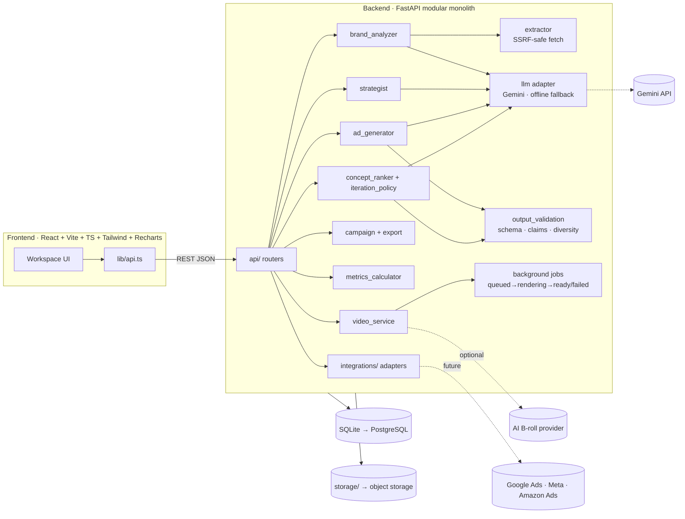

### Design decisions
| Decision | Why |
|---|---|
| Modular monolith, not microservices | One small codebase that is easy to run and change. Service boundaries live in code, not in infrastructure. |
| SQLite + SQLModel with JSON columns | Zero setup. The schema can change during the hackathon. `DATABASE_URL` switches to Postgres. |
| FastAPI `BackgroundTasks` for video jobs | No Redis or Celery needed. The job status lives in the `Asset` row. Can be swapped for a real queue later. |
| LLM behind an adapter + offline fallback | The demo never depends on an API being up. Every output records `generation_mode`. |
| Structured JSON + Pydantic validation + 1 retry | Reliable outputs that the UI can render and edit |
| Deterministic Python for all numbers | Auditable. LLMs don't do arithmetic here. |
| Provider adapters for ad platforms | The creative pipeline is never coupled to Google, Meta or Amazon access |

---

## 6. Data model

```
Brand ─┬─< Campaign ─┬─< Concept ─┬─< Asset (video/image)
       │             │            └─< MetricSnapshot
       │             └─< Iteration (each optimisation round)
       └─< Asset (logos / uploads)                AuditLog (any entity)
```

| Entity | Key fields |
|---|---|
| **Brand** (Brand Memory) | name, website, `profile` (BrandProfile JSON), `guardrails` (claims/words to avoid), `learnings` (what worked), `sources`, `warnings`, logo_path, generation_mode |
| **Campaign** | brand_id, name, objective (`awareness · traffic · leads · sales · engagement · launch`), channels, product_focus, `strategy` JSON, status (`draft · generated · approved · scheduled · published · failed`) |
| **Concept** | campaign_id, concept_type (`problem · demo · storytelling · offer · testimonial-style`), target_segment, angle, hook, primary_text, headline, cta, visual_brief, platform_copy, video_script, claim_sources, risk_flags, **parent_concept_id, changed_variables, is_exploration**, status (`generated · approved · rejected`), generation_mode, prompt_version |
| **Asset** | concept_id, kind (`video · image · upload`), fmt, path, status (`queued · rendering · ready · failed`), generation_mode (`template`, `template+ai_broll`, …), error |
| **MetricSnapshot** | concept_id, platform, day, impressions, clicks, conversions, spend, revenue, **source_type** (`simulated · imported_csv · api:<provider>`) |
| **Iteration** | objective_metric, insight_summary, ranking, selected_signals, limitations, data_sources |
| **AuditLog** | entity, entity_id, action (`approved`, `exported`, `generated`…), detail |

The source of truth is `backend/app/models.py`. Pydantic schemas are in `backend/app/schemas/`.

---

## 7. End-to-end workflow

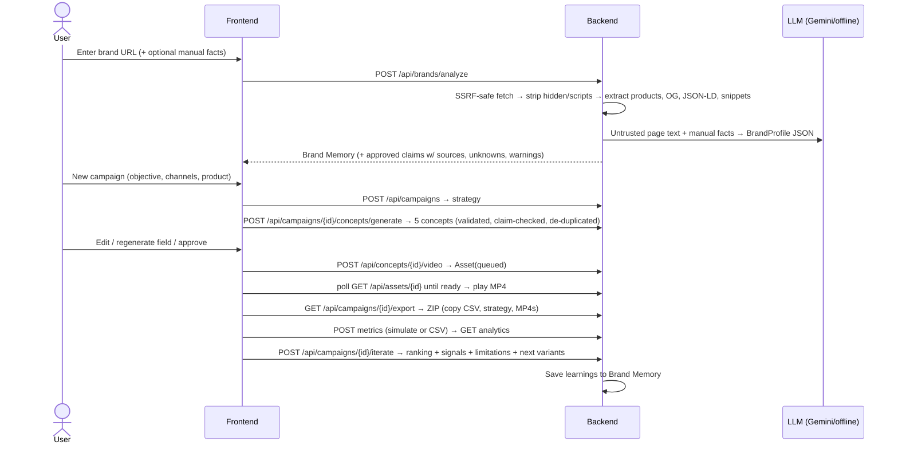

---

## 8. Video generation design

**Decision: hybrid. The real product is composited by code; AI is optional and only makes the scenery.**

Fully AI-generated video warps packaging, garbles label text and can show a product that doesn't exist. For an ad product that is a trust failure. So:

| Layer | Source | Always available? |
|---|---|---|
| Real product image(s), logo | Extracted from site / uploaded | ✅ |
| Hook, benefits, price, CTA text | Approved concept + approved claims | ✅ |
| Animation (slow zoom, slide-ins, word-by-word text, transitions) | Pillow frame rendering → FFmpeg H.264 | ✅ |
| Background | Brand-colour animated gradient (**default**) or AI scene footage (stretch) | Gradient ✅ / AI optional |
| Voiceover + subtitles | TTS provider (stretch) | Optional |
| Music | A track the team has rights to (`MUSIC_PATH`) | Optional |

**15-second 9:16 reel (1080×1920, 30 fps):**

| Time | Beat | On screen |
|---|---|---|
| 0–3 s | Hook | Bold hook revealed word by word over the background |
| 3–7 s | Product | Real product slides in, slow zoom, soft shadow, product name |
| 7–11 s | Benefits | 2–3 **approved** claims pop in one at a time |
| 11–15 s | CTA | Logo, price (only if extracted), CTA button, URL |

Each asset stores `generation_mode` (`template` / `template+ai_broll` / `template+tts`), and the UI shows it. A known-good backup MP4 is kept in `sample_data/` for the demo.

---

## 9. Optimization engine design

There is no foundation-model training. It's an **LLM-powered workflow with a transparent, testable decision layer**.

1. **Metrics (Python only).** CTR = clicks/impressions, CPC = spend/clicks, CVR = conversions/clicks, CPA = spend/conversions, ROAS = revenue/spend. Any metric with a zero denominator is `null` (shown as "—"), never 0.
2. **Objective → primary metric.** sales/leads → CVR (ROAS if revenue exists). traffic/engagement/launch → CTR. awareness → CTR as a labelled proxy.
3. **Sample-size gate.** `insufficient data` / `early signal` / `directional`, based on impressions, clicks and conversions. Raw counts are always shown beside the rates.
4. **Uncertainty.** A Wilson 95% interval for each rate, plus a Beta-Binomial Monte Carlo **P(best)** per concept. A winner is only called when intervals separate.
5. **Next batch (4 variants by default).**
   - About 75% **exploit**: take the top 1–2 concepts and change **one or two** variables (hook, CTA, headline, layout, segment).
   - About 25% **explore**: an under-tested concept type or angle.
   - Each variant stores `parent_concept_id`, `changed_variables`, `rationale` and the metric snapshot it used.
6. **Learnings → Brand Memory.** For example: "Problem-led hooks out-performed demo hooks on CTR (early signal, simulated data)."
7. **Limitations are always returned.** Simulated data, correlation is not causation, small samples.
8. **Trait and trend model.** A small empirical-Bayes beta-binomial model learns which creative traits (angle, audience, layout, hook style, CTA) beat the campaign average, with the evidence discounted for ad-to-ad noise, plus a weighted daily trend per ad that flags rising or fading creatives. The next batch uses it to pick a layout and an audience; the Performance page shows it as "What the model learned". It reports association, not cause.
9. **Optional ML on real data:** a heavier model only once real labelled campaign data exists (split by campaign or time, compared against a baseline). Not before.

---

## 10. Trust, safety and honesty rules

- Never invent testimonials, certifications, discounts, customer counts, ratings or performance numbers. Unsupported facts go to `unknowns_to_confirm`.
- Testimonial-style concepts are labelled **dramatization**, or they use real, approved material.
- Scraped content is **untrusted**: hidden elements and scripts are removed, and the LLM is told to ignore instructions inside it.
- The **claim guard** flags medical or cure language, "clinically proven", "#1/best", "100%", "guaranteed", and numbers or discounts not in the source.
- **SSRF protection:** http(s) only, standard ports, every redirect hop re-validated, private IPs blocked, size and time limits.
- Uploads are checked for type and size.
- Secrets stay in `backend/.env` only, never in the frontend bundle or git.
- Simulated metrics are tagged in the **database and the UI**.
- **Nothing is published and no money is spent** without explicit user approval. The MVP only exports.
- The audit log records approvals, exports and generations.

---

## 11. Ad platform integrations

The provider-adapter interface is `connect · validate · prepare_campaign · publish (requires approval) · fetch_metrics`.

| Provider | MVP | Notes (re-check current docs before building) |
|---|---|---|
| **Export** (ZIP: copy CSV, strategy JSON, MP4s) | ✅ Working | Works with any platform via manual upload |
| **Simulated** metrics | ✅ Working | Always labelled `simulated` |
| **CSV import** | ✅ Working | `source_type = imported_csv` |
| Google Ads API | Designed, not connected | For **advertisers**. Needs an OAuth + developer token, and production access requires Google approval. **Not AdSense**, which is for publishers monetising sites. |
| Meta Marketing API | Designed, not connected | Needs a Meta app, a business ad account, and app review for advanced access |
| Amazon Ads API | Designed, not connected | Needs registration/approval with Amazon Ads; verify eligibility first |
| Instagram organic publishing | Designed, not connected | Needs a business/creator account linked to a Facebook Page + app permissions |

The Integrations page shows exactly these statuses.

### Meko (by Yugabyte): shared agent memory ✅ live
[Meko](https://mekodata.netlify.app/) is Yugabyte's memory and knowledge layer for AI agents, built on YugabyteDB. AdPilot uses it as the cloud side of Brand Memory, so its agents share what they know and learn.

| AdPilot agent | When | Meko tools used |
|---|---|---|
| `adpilot-brand-agent` | After a brand is analyzed or edited | `conversation_create` → `datapack_create` (one datapack per brand) → `conversation_add_message` (sync trace) → `memory_add` (products, approved claims, tone, unknowns) |
| `adpilot-creative-agent` | Before and after generating concepts | `conversation_create` → `context_search` (past learnings fed into the Gemini prompt) → `conversation_add_message` (what was generated and the plan it followed) |
| `adpilot-analyst-agent` | After optimization (G3) | `memory_add` (what worked, labelled with its data source) → a **promotion policy in code** holds back learnings that rest on insufficient data → `memory_promote` (only the approved ones are shared) → `conversation_add_message` (the promoted / held decision and why, as a trace) |

### How AdPilot uses Meko (agents and memory)

AdPilot is built as three small agents that never call each other directly. They cooperate **through one shared Meko datapack per brand**: what one agent writes, another reads later.

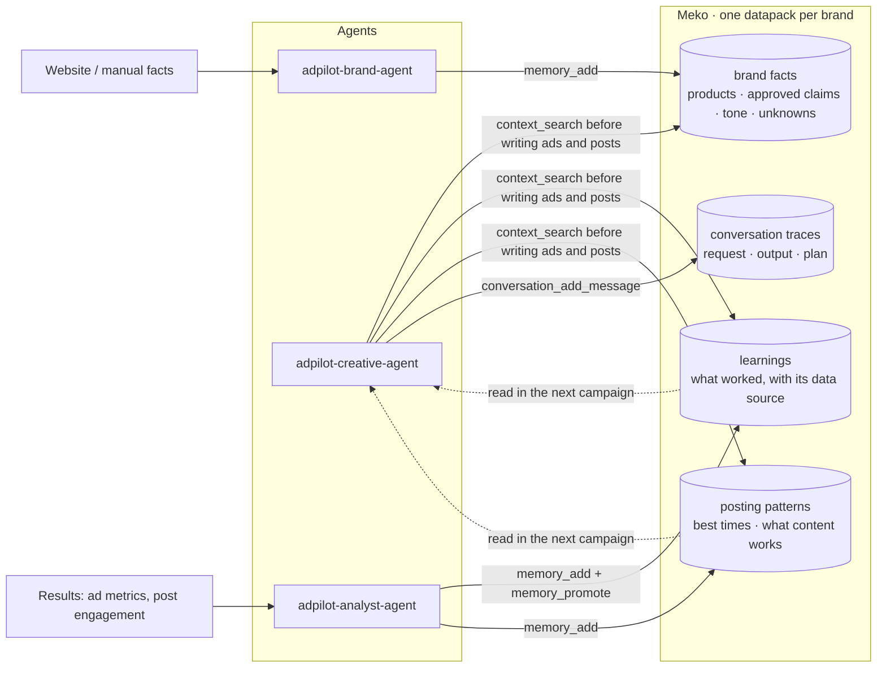

| Agent | Writes | Reads | When |
|---|---|---|---|
| `adpilot-brand-agent` | Brand facts, approved claims, tone, unknowns (`memory_add`) | | After a brand is analysed or edited |
| `adpilot-creative-agent` | A trace of each generation (`conversation_add_message`) | `context_search` over facts, learnings and posting patterns | Before and after writing ad concepts and social posts |
| `adpilot-analyst-agent` | Optimization learnings and posting patterns (`memory_add`), promoted with `memory_promote` so every agent sees them | | After a metrics iteration, and when posting patterns change |

**The loop that makes it learn:** results come in → the analyst turns them into learnings and posting patterns → they are promoted into the brand's shared memory → the creative agent finds them with `context_search` the next time it writes. The Meko card on the Performance page shows what is stored (counts per kind) and runs a live "what Meko recalls" search.

**Why this architecture**
- **One datapack per brand** keeps brands from mixing. Each brand's tone, claims and audience habits stay separate (Velvaa, Brew & Bloom and Threadline learn different posting times).
- **Agents share memory, not code paths.** Each agent has one job and one identity in Meko, so the memory trace shows who wrote what. New agents can be added without touching the others.
- **Meko is additive, not load-bearing.** Calls run as background jobs with timeouts and one retry. If Meko is unreachable the app keeps working on local Brand Memory and says "Not connected"; it never pretends.
- **Honest data.** Every memory records its source (for example `synthetic_history` or `simulated`), so demo data is never mistaken for real results.

How it's built:
- `backend/app/services/meko_memory.py` speaks MCP's streamable-HTTP protocol directly with `httpx` (no SDK dependency, because the `mcp` package's client API changed between v1 and v2).
- `backend/app/services/meko_sync.py` runs the syncs as background jobs, so Meko never slows the UI. The result is stored in `brand.integrations.meko` (`status`, `datapack_id`, `conversations`, …).
- Every call has a timeout. If Meko is unreachable, the app continues on local Brand Memory and shows the error on the Integrations page.
- Differences from the public docs, found against the live server (Meko MCP 3.2.4, 42 tools): `conversation_id` is required by `datapack_create`, `memory_add`, `context_search` and `memory_promote`; `metadata` must be a JSON string; errors can arrive wrapped as `{"result": "<json>"}`.
- **One datapack per brand** (named `AdPilot · <brand>`), so brands never mix. Ids are cached in `backend/.meko_datapacks.json` (git-ignored) so re-seeding reuses them. Free Meko plans cap the number of datapacks (10 when we tested); if you hit "datapack limit", delete unused datapacks in the Meko dashboard, or set `MEKO_DATAPACK_ID` to force one.
- It also stores **posting patterns** (best times, what content works) and reads them back: post and concept generation search the brand's datapack first, and `GET /api/brands/{id}/memory?recall=true` shows what Meko recalls. The Performance page has a "Meko memory" card with the written counts.
- More differences found on the live server: `datapack_list` needs a `conversation_id` and rejects `agent_id`. Calls to Meko are slow from some networks, so timeouts default to 20 s (45-60 s for writes) with one retry; raise `MEKO_TIMEOUT_S` if needed.
- Verify any time: `python -m app.scripts.meko_check` (ends with `ALL CALLS OK`), or `POST /api/integrations/meko/test`.

---

## 12. Tech stack

| Layer | Choice |
|---|---|
| Frontend | React 18, Vite, TypeScript, Tailwind CSS, Recharts, React Router, TanStack Query (handles polling and cache) |
| Backend | Python 3.11+, FastAPI, Uvicorn, Pydantic v2, SQLModel |
| AI | Gemini API (structured JSON output) behind `services/llm.py`, plus a deterministic offline provider |
| Extraction | httpx, BeautifulSoup4 (Trafilatura optional) |
| Video | Pillow (frames), FFmpeg (H.264 MP4), bundled fonts (Poppins, Lora). Optional TTS and AI B-roll |
| Data/stats | Python stdlib + NumPy (Wilson CI, Beta-Binomial P(best)), pandas for CSV |
| DB / storage | SQLite → PostgreSQL; local `storage/` → object storage |
| Tests | pytest + FastAPI TestClient |
| Deploy | Vercel (frontend) + a Python host with FFmpeg (e.g. Render/Railway/Fly). **Run the demo locally as primary.** |

---

## 13. Repository layout

```
adpilot-ai/
├── README.md                    ← you are here
├── docs/
│   ├── screenshots/             ✅ app screenshots used in this README
│   └── API_CONTRACT.md          ← request/response shapes shared by frontend and backend
├── backend/
│   ├── .env.example
│   ├── requirements.txt
│   ├── app/
│   │   ├── main.py              ✅ FastAPI app, CORS, /files, /demo-store, routers, /api/health
│   │   ├── config.py  db.py  models.py  serializers.py   ✅
│   │   ├── api/                 ✅ common brands campaigns concepts assets analytics integrations posts socials
│   │   ├── schemas/             ✅ brand.py concept.py
│   │   ├── services/
│   │   │   ├── extractor.py         ✅ SSRF-safe fetch, JSON-LD/OG/Shopify parsing, hidden-text stripping
│   │   │   ├── llm.py               ✅ Gemini + offline fallback, JSON validation + 1 retry
│   │   │   ├── brand_analyzer.py    ✅ → BrandProfile with grounded claims
│   │   │   ├── strategist.py        ✅ → CampaignStrategy
│   │   │   ├── ad_generator.py      ✅ → 5 concepts + platform copy + video script
│   │   │   ├── output_validation.py ✅ claim guard, diversity, platform limits
│   │   │   ├── text_utils.py        ✅ similarity, trimming helpers
│   │   │   ├── meko_memory.py       ✅ Meko MCP client (memories, context search, traces)
│   │   │   ├── meko_sync.py         ✅ background Meko sync jobs
│   │   │   ├── social_posts.py      ✅ LinkedIn / Instagram / X post generation + claim guard
│   │   │   ├── posting_insights.py  ✅ best day/time per platform, content patterns, next slots
│   │   │   ├── video_service.py     ✅ Pillow/FFmpeg renderer: real product image, 4 animated scenes
│   │   │   ├── video_jobs.py        ✅ background render job: queued → rendering → ready / failed
│   │   │   ├── export_service.py    ✅ ZIP export (copy CSV, strategy, concepts, videos, README)
│   │   │   ├── metrics_calculator.py ✅ CTR/CVR/CPC/CPA/ROAS, simulated data, CSV import
│   │   │   ├── concept_ranker.py    ✅ Wilson CI, P(best), sample-size gates, winner rule
│   │   │   ├── iteration_policy.py  ✅ 75% exploit / 25% explore plan, insight, limitations, learnings
│   │   ├── scripts/             ✅ reset_demo.py seed_history.py evaluate.py meko_check.py gemini_check.py gemini_ping.py make_demo_images.py export_fixtures.py
│   │   └── assets/fonts/        ✅ Poppins, Lora (SIL Open Font License)
│   └── tests/                   ✅ conftest.py test_api_flow.py test_video_export.py test_analytics.py test_eval.py test_ai_clip.py test_llm_providers.py test_resilience.py test_posts.py test_publishing.py (49 tests)
├── frontend/
│   └── src/  pages/ (Home, NewBrand, BrandMemory, Campaigns, campaign/{Strategy,Creatives,Launch,Performance}) components/ (SocialPosts, PublishPanel, PostsHub, ConnectedAccounts, PostingInsights, SocialPerformance, ...) lib/api.ts lib/types.ts   ✅ React 18 + TypeScript + Vite + Tailwind + TanStack Query + Recharts
└── sample_data/
    ├── demo_store/              fictional Indian skincare storefront (offline-safe demo URL)
    ├── fixtures/                real backend responses for frontend mocks
    ├── sample_metrics.csv       CSV import example
    └── backup_video.mp4         known-good demo video
```

---

## 14. API overview

The full request/response shapes and TypeScript types are in **[docs/API_CONTRACT.md](docs/API_CONTRACT.md)**.

| Method | Path | Purpose |
|---|---|---|
| GET | `/api/health` | LLM provider in use, FFmpeg availability |
| POST | `/api/brands/analyze` | URL and/or manual facts → Brand Memory |
| GET / PATCH | `/api/brands`, `/api/brands/{id}` | List, read and edit Brand Memory |
| POST | `/api/brands/{id}/uploads` | Logo / product images |
| POST | `/api/campaigns` | Create a campaign and generate its strategy |
| GET | `/api/campaigns?brand_id=`, `/api/campaigns/{id}` | List / detail (concepts, assets, iterations) |
| PATCH | `/api/campaigns/{id}` | Edit strategy or status (approve) |
| POST | `/api/campaigns/{id}/concepts/generate` | 5 concepts |
| PATCH | `/api/concepts/{id}` | Edit copy, approve or reject |
| POST | `/api/concepts/{id}/regenerate` | Regenerate one field |
| POST | `/api/concepts/{id}/video` | Start a video render job (202) |
| GET | `/api/assets/{id}`, `/api/assets?brand_id=` | Job status / asset library |
| GET | `/api/campaigns/{id}/export` | ZIP download |
| POST | `/api/campaigns/{id}/metrics/simulate` | Seed labelled simulated metrics |
| POST | `/api/campaigns/{id}/metrics` | CSV upload |
| GET | `/api/campaigns/{id}/analytics` | Totals, per-concept, daily, data provenance |
| POST | `/api/campaigns/{id}/iterate` | Ranking, signals, limitations, next variants |
| GET | `/api/integrations` | Honest provider statuses (Meko status is live) |
| POST | `/api/integrations/meko/test` | Live round-trip to Meko: tool count + datapacks |
| GET | `/api/concepts/{id}` | One concept with its latest video |
| GET | `/api/concepts/{id}/video-options` | Standard vs **Pro - AI video** (Pro needs an attached clip) |
| POST / DELETE | `/api/concepts/{id}/ai-clip` | Attach / remove an AI-generated clip for Pro mode |
| POST | `/api/concepts/{id}/posts/generate` | LinkedIn, Instagram and X post drafts |
| GET | `/api/campaigns/{id}/posts` | All posts for a campaign |
| PATCH / POST / DELETE | `/api/posts/{id}`, `/regenerate` | Edit, approve, regenerate or delete a post |
| POST / DELETE | `/api/posts/{id}/schedule` | Schedule (or unschedule) an approved post |
| POST | `/api/posts/{id}/publish` | Record a publish: `manual_share` (you pressed Post) or `simulated` |
| POST | `/api/posts/{id}/metrics` | Enter real results for a published post (labelled `manual`) |
| POST | `/api/campaigns/{id}/posts/simulate-engagement` | Labelled simulated engagement for the demo |
| GET | `/api/brands/{id}/posts`, `/posting-insights` | All posts for a brand; best times and what content works |
| GET | `/api/brands/{id}/memory?recall=` | What is stored in Meko; `recall=true` runs a live search |
| GET / PUT / DELETE | `/api/brands/{id}/socials[/{platform}]` | Link, list or unlink the brand's X / LinkedIn / Instagram accounts |


---

## 15. Demo script (≈4 minutes)

Demo brand: **Velvaa Skin**, a *fictional* Indian skincare brand served from `sample_data/demo_store` at `https://demo.adpilot.local/` (no internet needed).

1. **Brand Workspace:** paste the URL → Brand Memory appears. Point out approved claims with sources, unknowns to confirm, and the warning *"Ignored 1 hidden element"* (the hidden prompt-injection on the page).
2. **Strategist:** create a "Sales" campaign → positioning, segments, angles, channel plan, 7-day calendar.
3. **Creative Studio:** 5 distinct concepts, platform-specific copy, a risk flag on the testimonial-style concept.
4. Click **Generate video** → about 20 s → play the real MP4 (labelled `template`).
5. Edit a headline, regenerate a hook, **approve** 3 concepts → campaign moves to *Approved* → **Export ZIP**.
6. **Analytics:** load simulated data → the big **SIMULATED** banner → per-concept CVR with intervals and sample warnings.
7. **Optimize:** next 4 variants, each with "changed: hook — because…", one marked *exploration*, and the limitations listed.
8. **Social posts:** open a concept's *Social posts* tab, write posts for LinkedIn, Instagram and X, note the **best time** suggestion with its reason, approve and schedule one. *Post on LinkedIn* opens the platform with the text filled in; *I posted it* records it. (*Simulate publish* is the labelled demo shortcut.)
9. **Memory:** open *Performance*. The social learning curve, the learned best times and the Meko memory card show how each brand's history shapes the next post. Switch brand (Brew & Bloom, Threadline) and the patterns differ. The history is synthetic and labelled.
10. Back in **Brand Memory**, the learnings now appear there. Close on the ecosystem slide.

Have ready: the backup MP4, a pre-seeded database (`scripts/reset_demo`), and a screen recording.

---

## 16. Risks and mitigations

| Risk | Mitigation |
|---|---|
| LLM slow, down or invalid JSON | Pydantic validation, 1 retry, offline provider, timeouts, cached demo brand |
| Video looks cheap or renders slowly | Pre-rendered static layers, quick preview first, strong motion design, backup MP4 |
| Site blocks scraping or needs JavaScript | Shopify JSON → JSON-LD → Open Graph → text → manual. Bundled demo store. |
| Wi-Fi at venue | Everything runs locally. Offline LLM mode. Demo store needs no internet. |
| Integration overreach | Export + adapter design. Honest status page. |
| Scope creep | One end-to-end workflow first. Extras only once the core loop is solid. |

---

## 17. Long-term roadmap

1. **Brand Sources:** attach several sites to one brand (D2C store, marketplaces, Instagram, catalogue PDF), each read separately, merged into one Brand Memory with per-source evidence and conflict flags
2. Brand Safety & Compliance Checker as a full module (platform policy packs, ASCI rules)
2. Localization engine (Hindi, Hinglish, Tamil, Bengali; regional voiceover)
3. UTM & attribution assistant
4. Unified marketing assistant (chat over the shared brand and campaign data)
5. Content calendar with scheduling, plus team roles
6. Reusable templates by category, objective and platform
7. Real Meta / Google Ads connectors (OAuth, approval-gated publishing, reporting)
8. Market & competitor intelligence
9. Budget assistant (bounded by user budgets, approval required)
10. Contextual bandits / learned ranking once real data exists

---

## 18. Getting started

```bash
# backend
cd backend
python -m venv .venv && source .venv/bin/activate   # Windows: .venv\Scripts\activate
pip install -r requirements.txt
cp .env.example .env            # Windows: copy .env.example .env
#   GEMINI_API_KEY=...  optional; offline mode works without it
#   MEKO_API_KEY=...    from cloud.mekodata.ai → Settings → API Keys
#   GEMINI_MODEL=gemini-flash-lite-latest is the default; fallbacks are tried automatically
#   Backup AI providers (optional, free keys): GROQ_API_KEY, OPENROUTER_API_KEY, MISTRAL_API_KEY, or a local
#   Ollama (OLLAMA_MODEL=llama3.1:8b). If Gemini is down or out of quota, the next provider answers
#   automatically; if all are down, the offline generator still works. See GET /api/health -> providers.
# FFmpeg: installed automatically as a pip package (imageio-ffmpeg). A system FFmpeg is used if present.
#   Check: open http://localhost:8000/api/health and look for "ffmpeg": true
pytest -q                          # 49 passed (offline, never uses your real keys)
python -m app.scripts.meko_check   # ends with ALL CALLS OK when Meko is configured
python -m app.scripts.gemini_check # ends with GEMINI OK when Gemini is configured
python -m app.scripts.evaluate     # scorecard: 14/14 checks, saved to sample_data/fixtures/eval_scorecard.json
python -m app.scripts.reset_demo   # wipes the DB and rebuilds the Velvaa demo (add --offline or --no-video)
python -m app.scripts.seed_history # wipes the DB, builds 3 brands with 8 weeks of SYNTHETIC history, writes it to Meko
                                   #   --no-meko skips Meko (fast, offline); --gemini uses the real model for the past concepts
uvicorn app.main:app --reload --port 8000

# frontend
cd frontend
npm install
cp .env.example .env            # VITE_API_URL=http://localhost:8000
npm run dev                     # http://localhost:5173
```

API docs are auto-generated at `http://localhost:8000/docs`.

**Try it in 60 seconds:** open `/docs` → `POST /api/brands/analyze` with `{"url": "https://demo.adpilot.local/"}` → `POST /api/campaigns` with `{"brand_id": 1, "objective": "sales"}` → `POST /api/campaigns/1/concepts/generate` → `POST /api/concepts/1/video` → poll `GET /api/assets/1` until `ready`, then open its `url` in the browser → `PATCH /api/concepts/1` with `{"status": "approved"}` → `GET /api/campaigns/1/export` downloads the ZIP → `POST /api/campaigns/1/metrics/simulate` → `GET /api/campaigns/1/analytics` → `POST /api/campaigns/1/iterate` (4 new variants + learnings). A few seconds after analyzing, `GET /api/brands/1` shows `integrations.meko.status = "synced"`.

> New nullable columns are added to an existing SQLite database automatically on start. If something still looks inconsistent, delete `backend/adpilot.db`; it is recreated on start.

**Using the app:** start the backend (port 8000) and the frontend (port 5173), open `http://localhost:5173`, click **Add a brand**, paste `https://demo.adpilot.local/`, then Campaigns → New campaign → Creatives → Generate. In the sidebar footer, "LLM" shows whether Gemini or the offline generator is writing.

**Fixtures:** the JSON files in `sample_data/fixtures/` are real API responses (useful for UI work without a running backend). `sample_data/backup_video.mp4` is the demo backup video.


---

## 19. Reliability and extra features

- **AI provider chain.** Gemini first, then any configured OpenAI-compatible provider (Groq, OpenRouter, Mistral, Cerebras, a local Ollama, or a custom endpoint), then the offline generator. Each provider has its own circuit breaker, and the provider that answered is shown as the `generation_mode`.
- **Restart recovery.** On startup, renders left "queued/rendering" by a crash are marked failed (the UI offers retry), half-created brands are removed, and a stuck Meko sync is reset. SQLite runs in WAL mode with a 30 s lock wait, and any unexpected error returns a JSON 500 that still carries CORS headers.
- **Social posts.** One click turns a concept into a LinkedIn post, an Instagram caption (with reel/carousel idea) and an X post plus 3-post thread. Each post gets its **top 5 tags**, ordered brand → product → niche → community → region (a fixed rule, not live trend data); you can add or remove each one. Same claim guard, platform limits, edit/approve flow and export as ad copy. Drafts only.
- **Pro - AI video.** An optional second video mode that puts the verified copy and CTA over an AI-generated clip attached to the concept. Standard video stays the default.
- **Posting intelligence.** From a brand's published posts it computes engagement (likes + 2×comments + 3×shares + clicks, over impressions) per weekday and part of the day in IST, shrinks thin cells toward the platform average, and reports the best slots, what content type and hook style works, and a plain-language summary. These feed the post prompt and the suggested time, and are written to Meko only when they change.
- **Synthetic demo history.** `seed_history` builds Velvaa Skin, Brew & Bloom and Threadline, each with 4 past campaigns, approvals, simulated ad metrics, optimization learnings and 72 published posts. Each brand has hidden audience habits (for example a different best slot per platform) that the insights engine has to rediscover from the data, so the learning is real even though the data is not. Everything is labelled `synthetic_history` in the database, the UI and Meko.
- **Connected accounts.** Link a brand's X, LinkedIn and Instagram handles. They are used for "Posting as @handle" and profile links.

---

## 20. Honest limits

- **AdPilot does not post for you.** Publishing is "you press Post on the platform": we open X or LinkedIn with your text filled in (Instagram can't be pre-filled, so the caption is copied), then you confirm. *Simulate publish* records a demo publish and is labelled. Real posting through the X, LinkedIn and Instagram APIs needs each platform's developer-app approval, so those adapters are designed but not connected.
- **Linking an account is not logging in.** It stores a handle and profile link only.
- **Demo data is synthetic.** The 8-week history and its engagement numbers were generated for the demo, and are labelled so in the database, the UI and Meko. Ad metrics are simulated or imported from CSV, never fetched from an ad platform.
- **Posting times are statistics, not promises.** Cells with few posts are marked low-confidence, and the app shows how many posts each suggestion rests on.
- **Meko needs a key and a network that reaches it.** Without `MEKO_API_KEY` the app runs on local Brand Memory and says "Not connected".
- **No real spend.** Nothing is published and no money is spent without explicit approval, and the MVP never spends money at all.
