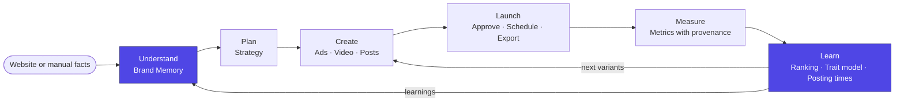
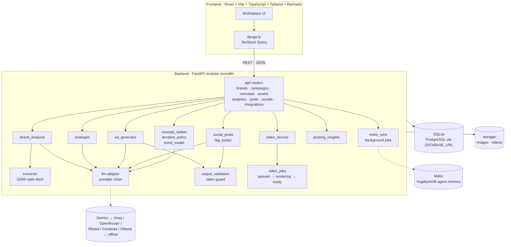
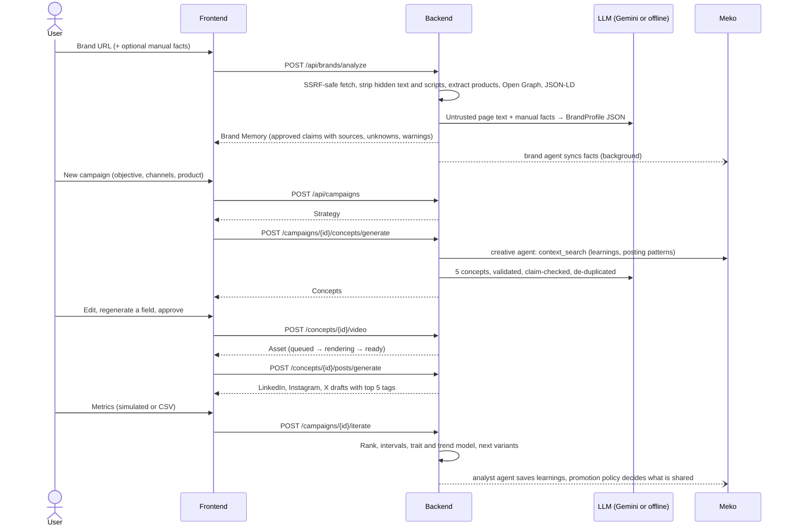
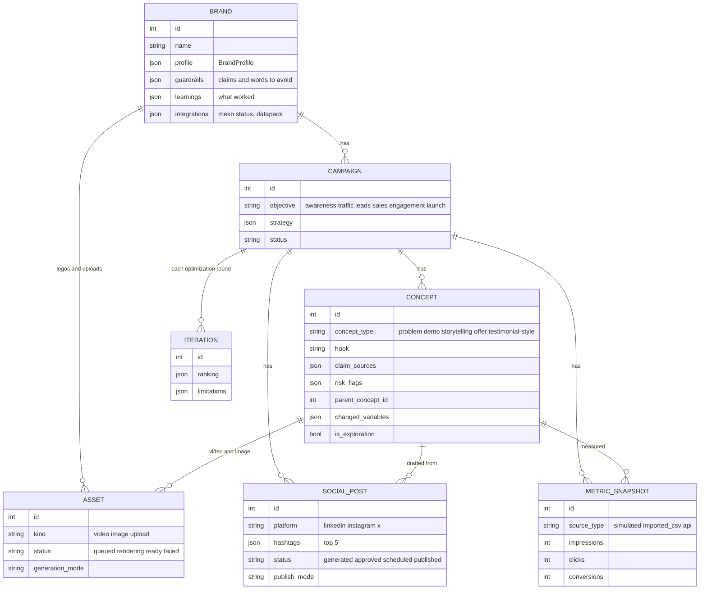
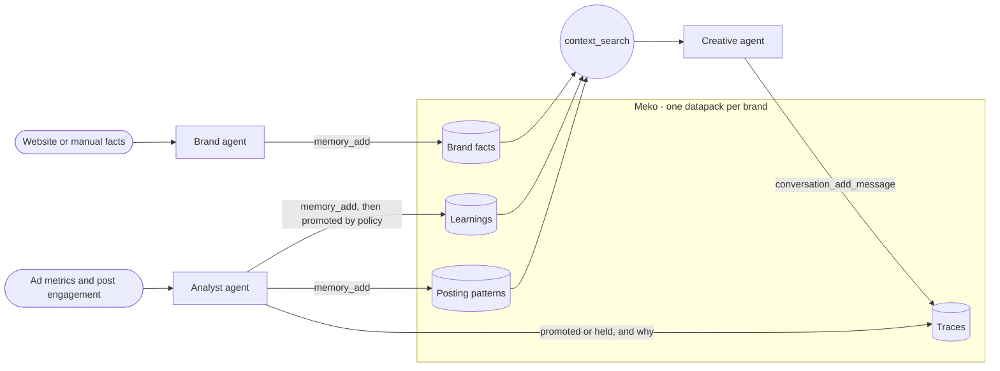
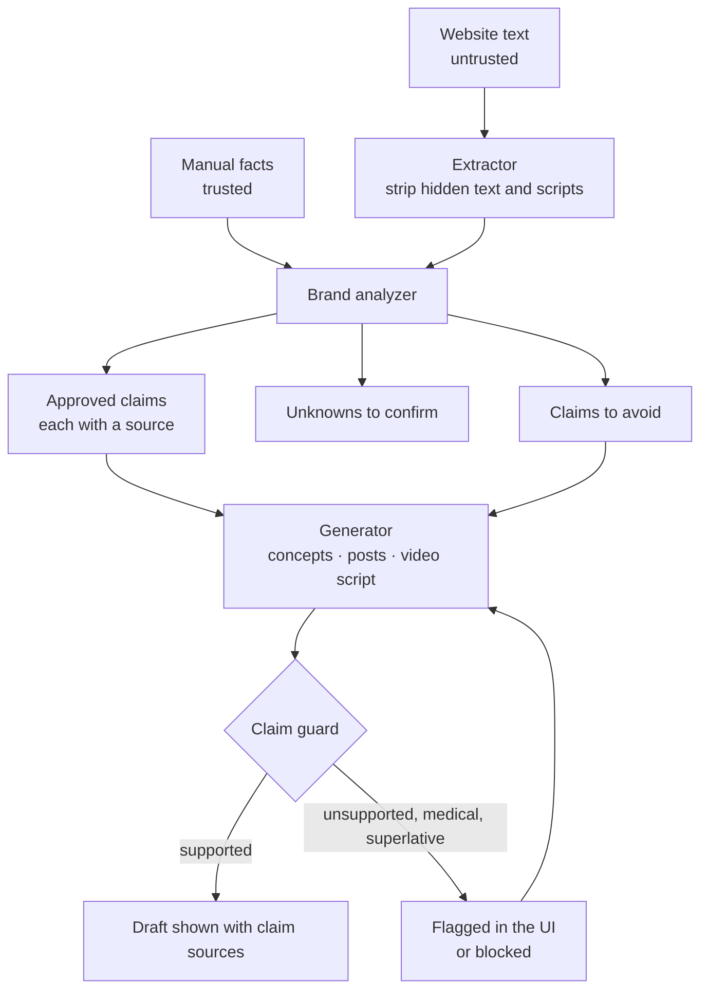
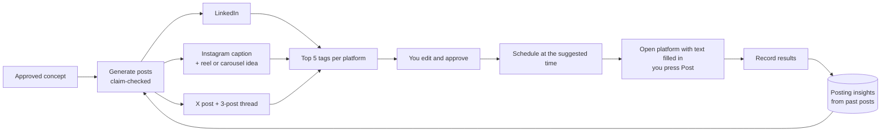
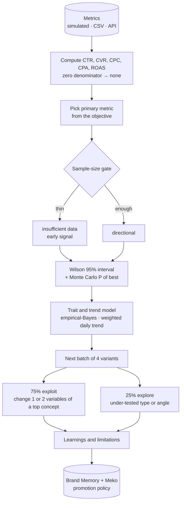

<a id="readme-top"></a>

<div align="center">

[](backend/tests)
[](backend/app/scripts/evaluate.py)
[](#meko-shared-agent-memory)
[](https://github.com/Shyam1922/AdPilot-AI/issues)

</div>

<br />
<div align="center">
  <a href="https://github.com/Shyam1922/AdPilot-AI">
    
  </a>

  <p align="center">
    Learn a brand once. Plan, create, launch and improve its campaigns, with every claim grounded in the brand's own product facts.
    <br />
    <br />
    <a href="docs/API_CONTRACT.md"><strong>Explore the API contract »</strong></a>
    ·
    <a href="#getting-started">Getting started</a>
    ·
    <a href="https://github.com/Shyam1922/AdPilot-AI/issues/new?labels=bug">Report a bug</a>
    ·
    <a href="https://github.com/Shyam1922/AdPilot-AI/issues/new?labels=enhancement">Request a feature</a>
  </p>
</div>

<details>
  <summary>Table of contents</summary>
  <ol>
    <li>
      <a href="#about-the-project">About the project</a>
      <ul>
        <li><a href="#what-it-does">What it does</a></li>
        <li><a href="#the-honesty-contract">The honesty contract</a></li>
        <li><a href="#built-with">Built with</a></li>
      </ul>
    </li>
    <li><a href="#screenshots">Screenshots</a></li>
    <li>
      <a href="#how-it-works">How it works</a>
      <ul>
        <li><a href="#the-closed-loop">The closed loop</a></li>
        <li><a href="#architecture">Architecture</a></li>
        <li><a href="#end-to-end-workflow">End-to-end workflow</a></li>
        <li><a href="#data-model">Data model</a></li>
      </ul>
    </li>
    <li><a href="#features">Features</a></li>
    <li>
      <a href="#meko-shared-agent-memory">Meko: shared agent memory</a>
    </li>
    <li><a href="#claim-grounded-generation">Claim-grounded generation</a></li>
    <li><a href="#video-generation">Video generation</a></li>
    <li><a href="#social-posts-and-posting-intelligence">Social posts and posting intelligence</a></li>
    <li><a href="#optimization-engine">Optimization engine</a></li>
    <li><a href="#trust-and-safety">Trust and safety</a></li>
    <li><a href="#getting-started">Getting started</a></li>
    <li><a href="#usage">Usage</a></li>
    <li><a href="#api">API</a></li>
    <li><a href="#testing-and-evaluation">Testing and evaluation</a></li>
    <li><a href="#repository-layout">Repository layout</a></li>
    <li><a href="#honest-limits">Honest limits</a></li>
    <li><a href="#roadmap">Roadmap</a></li>
    <li><a href="#acknowledgments">Acknowledgments</a></li>
  </ol>
</details>

<!-- ABOUT -->
## About the project

Small Indian D2C brands and SMEs rarely have an agency, yet they need fresh creative every week and can't tell which ad is working. Generic AI writers make this worse: they invent claims, forget the brand between sessions, and never learn from results.

**AdPilot AI is one workspace that behaves like a marketing team sharing one memory.** It reads a brand's website, remembers what is true about it, and uses that to plan campaigns, write ads and posts, render video, and learn from what happens next.

### What it does

1. **Learns a brand** from its website or manual facts: products, tone, audience hypotheses, **approved claims with their source**, and the claims it must *not* make.
2. **Plans and creates:** a campaign strategy, five distinct ad concepts, a real MP4 video ad, and ready-to-post LinkedIn, Instagram and X content in English, Hinglish or Hindi.
3. **Launches honestly:** you approve, schedule and export. AdPilot suggests the best time to post and opens the platform with your text filled in. It never posts or spends money by itself.
4. **Measures and learns:** results (simulated, CSV, or entered by hand, always labelled) feed a ranking with confidence intervals, a small trend model, new variants and a posting-time model. What it learns is written to **Meko** shared memory and used in the next campaign.

### The honesty contract

- Every claim is either **approved, with its source**, or **unknown, please confirm**. Nothing is invented.
- All numbers are computed in Python, never by the LLM. Small samples are labelled as such.
- Simulated, imported and manual data are tagged in the database and in the UI.
- AdPilot **never publishes and never spends money** without an explicit user action.
- Every AI output records which provider produced it (`generation_mode`), and the app works fully offline.

<p align="right">(<a href="#readme-top">back to top</a>)</p>

### Built with

[![React][react-shield]][react-url]
[![Vite][vite-shield]][vite-url]
[![TypeScript][ts-shield]][ts-url]
[![Tailwind][tw-shield]][tw-url]
[![FastAPI][fastapi-shield]][fastapi-url]
[![Pydantic][pydantic-shield]][pydantic-url]
[![SQLite][sqlite-shield]][sqlite-url]
[![FFmpeg][ffmpeg-shield]][ffmpeg-url]
[![Gemini][gemini-shield]][gemini-url]
[![Meko][meko-shield]][meko-url]

<p align="right">(<a href="#readme-top">back to top</a>)</p>

<!-- SCREENSHOTS -->
## Screenshots

Captured from the running app. The brand is the fictional *Velvaa Skin*. The posting history shown is **synthetic demo data and is labelled that way in the app**.

| | |
|---|---|
|  **Home:** three demo brands, each with its own memory |  **Brand Memory:** profile, products, approved claims, warnings |
|  **Strategy:** segments, channel plan, 7-day calendar, "Not claimed" |  **Creatives › Ads:** editable copy, claim guard, video, approve / reject |
|  **Creatives › Social posts:** LinkedIn / Instagram / X, top 5 tags, best-time suggestion |  **Launch:** approved creatives, export, publishing hub, linked accounts |
|  **Performance:** what the model learned, learned posting times, ad results | |

**Generated videos:** one look per concept type (problem, demo, storytelling, offer, customer-voice). The real product photo is on screen from the first seconds, rendered by Python and FFmpeg from the brand's own images.


<p align="right">(<a href="#readme-top">back to top</a>)</p>

<!-- HOW IT WORKS -->
## How it works

### The closed loop

The loop is the product: **understand → plan → create → launch → measure → learn → create better.** Everything sits on one Brand Memory that every step reads and the learning step writes back to.



### Architecture

A **modular monolith**: one FastAPI app, with each module a service package behind a clear boundary, so any of them can become its own service later.



| Decision | Why |
|---|---|
| Modular monolith | One small codebase that is easy to run and change. Boundaries live in code, not infrastructure. |
| SQLite + SQLModel with JSON columns | Zero setup and a flexible schema. `DATABASE_URL` switches database. |
| FastAPI `BackgroundTasks` for video and Meko jobs | No Redis or Celery. Job state lives in the `Asset` row and in `brand.integrations`. |
| LLM behind an adapter with an offline fallback | The app never depends on an API being up. Every output records its `generation_mode`. |
| Structured JSON + Pydantic validation + one retry | Outputs the UI can render and edit. |
| Deterministic Python for every number | Auditable. The LLM does no arithmetic here. |
| Provider adapters for ad platforms | The creative pipeline is never coupled to Google, Meta or Amazon access. |

### End-to-end workflow



### Data model



The source of truth is [`backend/app/models.py`](backend/app/models.py). Pydantic schemas are in [`backend/app/schemas/`](backend/app/schemas).

<p align="right">(<a href="#readme-top">back to top</a>)</p>

<!-- FEATURES -->
## Features

| Area | What it does | Status |
|---|---|---|
| **Website extraction** | Shopify feed, JSON-LD, Open Graph, page text; SSRF guard; hidden-text stripping | Done |
| **Brand Memory** | Claim grounding with sources, audience hypotheses, unknowns to confirm, brand colours, editable | Done |
| **Strategist** | Objective-aware plan for 6 objectives: positioning, segments, angles, channels, 7-day calendar, "Not claimed" | Done |
| **Ad generator** | 5 distinct concepts with platform copy for Instagram, Meta Ads and Google Ads; English, Hindi, Hinglish | Done |
| **Claim guard** | Flags medical or cure language, "#1/best", "100%", "guaranteed", and numbers not in the source | Done |
| **Video ads** | Real MP4, 5 visual styles, 9:16 / 1:1 / 4:5, a different script per concept type, export ZIP, optional Pro AI-clip mode | Done |
| **Social posts** | LinkedIn, Instagram and X (with thread), claim-checked, **top 5 tags per platform**, edit, approve | Done |
| **Scheduling and publishing** | Best-time suggestion, share-intent links, record the result | Done |
| **Posting intelligence** | Best day and time per platform and what content works, learned from past posts | Done |
| **Optimization** | Wilson intervals, P(best), trait and trend model, 4 next variants (exploit and explore) | Done |
| **Meko shared memory** | One datapack per brand; three agents; promotion policy in code | Live |
| **Brand management** | Create, edit, upload images, link social accounts, **delete a brand with everything under it** | Done |
| **Reliability** | Provider chain with circuit breakers, restart recovery, SQLite auto-migration, JSON 500s with CORS | Done |
| Real posting through platform APIs, ad-platform connectors | Adapters designed | Not connected |

<p align="right">(<a href="#readme-top">back to top</a>)</p>

<!-- MEKO -->
## Meko: shared agent memory

[Meko](https://mekodata.netlify.app/) is Yugabyte's memory and knowledge layer for AI agents, built on YugabyteDB. AdPilot uses it as the cloud side of Brand Memory.

AdPilot is built as **three small agents that never call each other directly.** They cooperate through **one shared datapack per brand** (named `AdPilot · <brand>`): what one agent writes, another reads later.



| Agent | Writes | Reads | When |
|---|---|---|---|
| `adpilot-brand-agent` | Brand facts, approved claims, tone, unknowns (`memory_add`) | | After a brand is analysed or edited |
| `adpilot-creative-agent` | A trace of each generation (`conversation_add_message`) | `context_search` over facts, learnings and posting patterns | Before and after writing ad concepts and posts |
| `adpilot-analyst-agent` | Learnings and posting patterns (`memory_add`), shared with `memory_promote` | | After an optimization round, and when posting patterns change |

**Who decides what is shared?** Code, not the model. A **promotion policy** holds back any learning that rests on insufficient data or is too short to be useful; only approved learnings are promoted to the brand's shared memory, and the promoted/held decision is written to the trace with its reason.

**The loop that makes it learn:** results arrive → the analyst turns them into learnings and posting patterns → the policy promotes the trustworthy ones → the creative agent finds them with `context_search` the next time it writes.

**Why this design**
- **One datapack per brand** keeps tenants isolated. Each brand's tone, claims and audience habits stay separate.
- **Agents share memory, not code paths.** One job and one identity per agent, so the trace shows who wrote what. A new agent can be added without touching the others.
- **Meko is additive, not load-bearing.** Calls run as background jobs with timeouts and one retry. If Meko is unreachable the app keeps working on local Brand Memory and says "Not connected".
- **Honest data.** Every memory records its source (for example `synthetic_history` or `simulated`).

**Implementation notes**
- [`meko_memory.py`](backend/app/services/meko_memory.py) speaks MCP's streamable-HTTP protocol directly with `httpx` (no SDK dependency). [`meko_sync.py`](backend/app/services/meko_sync.py) runs the sync jobs and stores the result in `brand.integrations.meko`.
- Differences from the public docs, found against the live server (Meko MCP 3.2.4, 42 tools): `conversation_id` is required by `datapack_create`, `memory_add`, `context_search` and `memory_promote`; `metadata` must be a JSON string; errors can arrive wrapped as `{"result": "<json>"}`.
- Datapack ids are cached in `backend/.meko_datapacks.json` (git-ignored). Free plans cap the number of datapacks; delete unused ones in the Meko dashboard or set `MEKO_DATAPACK_ID` to force one.
- Verify any time with `python -m app.scripts.meko_check` (ends with `ALL CALLS OK`) or `POST /api/integrations/meko/test`. `GET /api/brands/{id}/memory?recall=true` shows what Meko recalls.

<p align="right">(<a href="#readme-top">back to top</a>)</p>

<!-- CLAIMS -->
## Claim-grounded generation



- Concepts, posts and video scripts use **only approved claims**, the real price when it exists, and the brand's own value propositions.
- Testimonial-style concepts never invent a customer quote. They are written as a relatable moment in the brand's voice and keep the **dramatization** label.
- The Strategy page always shows a **Not claimed** list so the team can see what AdPilot refused to say.

<p align="right">(<a href="#readme-top">back to top</a>)</p>

<!-- VIDEO -->
## Video generation

**Hybrid by design: the real product is composited by code; AI is optional and only makes scenery.** Fully AI-generated video warps packaging, garbles label text and can show a product that does not exist. For an ad product that is a trust failure.

| Layer | Source | Always available |
|---|---|---|
| Product images and logo | Extracted from the site or uploaded | Yes |
| Hook, benefits, price, CTA | Approved concept and approved claims | Yes |
| Animation | Pillow frames → FFmpeg H.264 | Yes |
| Background | Brand-colour animated gradient (default), or AI footage in Pro mode | Gradient yes, AI optional |
| Music | A track you have rights to (`MUSIC_PATH`) | Optional |

```mermaid
gantt
    title A 15 second 9:16 reel (1080×1920, 30 fps). Pacing varies by concept type.
    dateFormat  s
    axisFormat  %Ss
    section Beats
    Hook, revealed word by word       :a1, 0, 3s
    Real product slides in            :a2, after a1, 4s
    2-3 approved claims pop in        :a3, after a2, 4s
    Logo, price, CTA, URL             :a4, after a3, 4s
```



Each concept type has its own script: problem-led, demo, storytelling, offer and customer-voice differ in pace, lead claim and voiceover wording. Each asset stores its `generation_mode` and the UI shows it. If a site has no usable product photo, the video uses a plain brand tile (never a fake product drawing) and the API flags `needs_product_image`.

**Pro, AI video** is an optional second mode that puts the verified copy and CTA over an AI-generated clip attached to the concept. The app produces a single, concept-specific, director-style prompt for it (one action and one camera move per shot, product kept identical, no on-screen text), and nothing is generated until you attach a clip.

<p align="right">(<a href="#readme-top">back to top</a>)</p>

<!-- SOCIAL -->
## Social posts and posting intelligence



- **Top 5 tags per post**, ordered brand → product (from approved claims) → niche → community → region. It is a fixed rule, not live trend data, and the UI says so. Click a tag to add or remove it. X uses two in the text, as the platform recommends.
- **Posting intelligence** computes engagement per weekday and part of the day in IST from a brand's published posts, shrinks thin cells toward the platform average, and reports the best slots, the content type and hook style that work, and how many posts each suggestion rests on.
- **Connected accounts** link a brand's X, LinkedIn and Instagram handles for "Posting as @handle" and profile links. This stores a handle only; it is not a login.

<p align="right">(<a href="#readme-top">back to top</a>)</p>

<!-- OPTIMIZATION -->
## Optimization engine

There is no foundation-model training. It is an **LLM-powered workflow with a transparent, testable decision layer.**



1. **Metrics in Python only.** A metric with a zero denominator is shown as "—", never 0.
2. **Objective → primary metric.** sales and leads → CVR (ROAS if revenue exists); traffic, engagement, launch → CTR; awareness → CTR as a labelled proxy.
3. **Sample-size gate** (`insufficient data`, `early signal`, `directional`). Raw counts always sit beside the rates.
4. **Uncertainty.** Wilson intervals plus a Beta-Binomial Monte Carlo **P(best)**. A winner is called only when intervals separate.
5. **Trait and trend model.** An empirical-Bayes beta-binomial model estimates which creative traits (angle, audience, layout, hook style, CTA) beat the campaign average, discounting evidence for ad-to-ad noise, plus a weighted daily trend that flags rising or fading ads. The next batch uses it to pick a layout and an audience, and the Performance page shows it as "What the model learned". It reports **association, not cause**.
6. **Next batch.** Each variant stores `parent_concept_id`, `changed_variables`, a rationale and the evidence it used.
7. **Limitations are always returned:** simulated data, correlation is not causation, small samples.

<p align="right">(<a href="#readme-top">back to top</a>)</p>

<!-- TRUST -->
## Trust and safety

- **No invented proof.** No fake testimonials, certifications, discounts, customer counts, ratings or performance numbers. Unsupported facts go to `unknowns_to_confirm`.
- **Scraped content is untrusted.** Hidden elements and scripts are removed and the LLM is told to ignore instructions inside the page.
- **SSRF protection.** http(s) only, standard ports, every redirect hop re-validated, private IPs blocked, size and time limits.
- **Uploads** are checked for type and size. **Secrets** stay in `backend/.env` and never reach the frontend bundle or git.
- **Provenance everywhere.** Simulated metrics are tagged in the database and the UI.
- **Explicit approval.** Nothing is published and no money is spent without a user action. The MVP only exports.
- **Audit log** of approvals, exports, generations and deletions.
- **India-aware.** INR pricing, Hindi and Hinglish, and a claim guard aimed at the kind of misleading claims the ASCI code targets.

<p align="right">(<a href="#readme-top">back to top</a>)</p>

<!-- GETTING STARTED -->
## Getting started

### Prerequisites

* Python 3.11+
* Node.js 18+ and npm
* FFmpeg is installed automatically as a pip package (`imageio-ffmpeg`); a system FFmpeg is used if present.
* Optional keys: `GEMINI_API_KEY` (any one of the backup providers also works), `MEKO_API_KEY`. The app runs without either.

### Installation

**Backend**

```sh
cd backend
python -m venv .venv && source .venv/bin/activate   # Windows: .venv\Scripts\activate
pip install -r requirements.txt
cp .env.example .env                                # Windows: copy .env.example .env
uvicorn app.main:app --reload --port 8000
```

Open `http://localhost:8000/api/health` and look for `"ffmpeg": true`. Interactive API docs are at `http://localhost:8000/docs`.

**Frontend**, in a second terminal:

```sh
cd frontend
npm install
cp .env.example .env            # VITE_API_URL=http://localhost:8000
npm run dev                     # http://localhost:5173
```

### Configuration

Set values in `backend/.env`. Everything is optional.

| Variable | Purpose |
|---|---|
| `GEMINI_API_KEY`, `GEMINI_MODEL` | Primary LLM. Fallback models are tried automatically. |
| `GROQ_API_KEY`, `OPENROUTER_API_KEY`, `MISTRAL_API_KEY`, `CEREBRAS_API_KEY`, `OLLAMA_MODEL`, `CUSTOM_LLM_URL` | Backup providers, tried in `LLM_PROVIDERS` order. If every provider is down the offline generator answers. |
| `MEKO_API_KEY` | Enables Meko shared memory (cloud.mekodata.ai → Settings → API Keys). |
| `DATABASE_URL`, `STORAGE_DIR` | Database and file storage. |
| `FRONTEND_ORIGINS` | Allowed CORS origins. |
| `MUSIC_PATH` | Optional music track you have rights to. |

### Demo data

```sh
python -m app.scripts.reset_demo     # wipe and rebuild the Velvaa demo (add --offline or --no-video)
python -m app.scripts.seed_history   # 3 brands with 8 weeks of SYNTHETIC history, written to Meko
                                     #   --no-meko skips Meko; --gemini uses the real model for past concepts
```

> New nullable columns are added to an existing SQLite database automatically on start. If anything looks inconsistent, delete `backend/adpilot.db`; it is recreated on start.

<p align="right">(<a href="#readme-top">back to top</a>)</p>

<!-- USAGE -->
## Usage

The demo brand is **Velvaa Skin**, a fictional Indian skincare brand served from `sample_data/demo_store` at `https://demo.adpilot.local/`, so no internet is needed.

1. **Add a brand.** Paste the URL. Brand Memory appears with approved claims and their sources, unknowns to confirm, and a warning that a hidden element on the page was ignored.
2. **Create a campaign.** Pick an objective. The strategy shows positioning, segments, angles, a channel plan, a 7-day calendar and the **Not claimed** list.
3. **Creatives › Ads.** Five concepts with platform copy and risk flags. Edit, regenerate one field, approve, then **Generate video** and play the MP4.
4. **Creatives › Social posts.** Write LinkedIn, Instagram and X posts, adjust the **top 5 tags**, check the best-time suggestion, approve and schedule. *Post on LinkedIn* opens the platform with your text filled in; *I posted it* records it.
5. **Launch.** Export the ZIP (copy CSV, strategy JSON, videos) and manage linked accounts.
6. **Performance.** Load labelled simulated data or upload a CSV, then read the ranking, intervals and **What the model learned**. **Optimize** creates four new variants with their reasons.
7. **Memory.** The learning is written to Brand Memory and to Meko. Switch brand and the patterns differ.
8. **Delete a brand** from the bottom of its Brand Memory page. This removes its campaigns, creatives, posts, videos, metrics and files.

**Try the API in a minute:** `POST /api/brands/analyze` with `{"url": "https://demo.adpilot.local/"}` → `POST /api/campaigns` with `{"brand_id": 1, "objective": "sales"}` → `POST /api/campaigns/1/concepts/generate` → `POST /api/concepts/1/video` → poll `GET /api/assets/1` until `ready` → `PATCH /api/concepts/1` with `{"status": "approved"}` → `GET /api/campaigns/1/export` → `POST /api/campaigns/1/metrics/simulate` → `POST /api/campaigns/1/iterate`.

<p align="right">(<a href="#readme-top">back to top</a>)</p>

<!-- API -->
## API

Full request and response shapes and TypeScript types are in **[docs/API_CONTRACT.md](docs/API_CONTRACT.md)**.

| Method | Path | Purpose |
|---|---|---|
| GET | `/api/health` | LLM providers in use, FFmpeg availability |
| POST | `/api/brands/analyze` | URL and/or manual facts → Brand Memory |
| GET / PATCH / **DELETE** | `/api/brands`, `/api/brands/{id}` | List, read, edit, or delete a brand and everything under it |
| POST | `/api/brands/{id}/uploads` | Logo and product images |
| POST | `/api/campaigns` | Create a campaign and its strategy |
| GET / PATCH | `/api/campaigns`, `/api/campaigns/{id}` | List, detail, edit strategy or status |
| POST | `/api/campaigns/{id}/concepts/generate` | Five concepts |
| PATCH / POST | `/api/concepts/{id}`, `/regenerate` | Edit, approve, reject, regenerate one field |
| POST | `/api/concepts/{id}/video` | Start a video render job |
| GET | `/api/assets/{id}`, `/api/assets?brand_id=` | Job status, asset library |
| GET | `/api/campaigns/{id}/export` | ZIP download |
| POST | `/api/campaigns/{id}/metrics/simulate`, `/metrics` | Labelled simulated metrics, CSV upload |
| GET | `/api/campaigns/{id}/analytics` | Totals, per concept, daily, provenance, trait and trend model |
| POST | `/api/campaigns/{id}/iterate` | Ranking, signals, limitations, next variants |
| POST | `/api/concepts/{id}/posts/generate` | LinkedIn, Instagram and X drafts |
| GET | `/api/campaigns/{id}/posts`, `/api/brands/{id}/posts` | Posts for a campaign or brand |
| PATCH / POST / DELETE | `/api/posts/{id}`, `/regenerate` | Edit, approve, regenerate, delete a post |
| POST / DELETE | `/api/posts/{id}/schedule` | Schedule or unschedule an approved post |
| POST | `/api/posts/{id}/publish`, `/metrics` | Record a publish, enter real results |
| GET | `/api/brands/{id}/posting-insights` | Best times and what content works |
| GET / PUT / DELETE | `/api/brands/{id}/socials[/{platform}]` | Link, list or unlink social accounts |
| GET | `/api/brands/{id}/memory?recall=` | What is stored in Meko; `recall=true` runs a live search |
| GET / POST | `/api/integrations`, `/api/integrations/meko/test` | Honest provider statuses, live Meko round trip |

<p align="right">(<a href="#readme-top">back to top</a>)</p>

<!-- TESTING -->
## Testing and evaluation

```sh
cd backend
pytest -q                          # 50 passed, offline, never uses your real keys
python -m app.scripts.evaluate     # scorecard: 14/14 checks, saved to sample_data/fixtures/eval_scorecard.json
python -m app.scripts.meko_check   # ends with ALL CALLS OK when Meko is configured
python -m app.scripts.gemini_check # ends with GEMINI OK when Gemini is configured
```

The tests use an isolated temporary database and storage with the offline LLM, and cover the full API flow, claim guard, video rendering and export, analytics and the trait and trend model, tags, publishing, provider fallback, restart recovery and brand deletion. The Meko director and promotion policy are tested with fakes; the live Meko round trip is checked by `meko_check`.

<p align="right">(<a href="#readme-top">back to top</a>)</p>

<!-- LAYOUT -->
## Repository layout

```
adpilot-ai/
├── README.md
├── docs/
│   ├── assets/                  logo and banner
│   ├── screenshots/             app screenshots used in this README
│   └── API_CONTRACT.md          request and response shapes shared by frontend and backend
├── backend/
│   ├── .env.example  requirements.txt
│   ├── app/
│   │   ├── main.py  config.py  db.py  models.py  serializers.py
│   │   ├── api/                 brands campaigns concepts assets analytics integrations posts socials
│   │   ├── schemas/             brand.py concept.py
│   │   ├── services/
│   │   │   ├── extractor.py            SSRF-safe fetch, JSON-LD / Open Graph / Shopify parsing
│   │   │   ├── llm.py                  provider chain, offline fallback, JSON validation and retry
│   │   │   ├── brand_analyzer.py       BrandProfile with grounded claims
│   │   │   ├── strategist.py           CampaignStrategy
│   │   │   ├── ad_generator.py         5 concepts, platform copy, per-type video scripts
│   │   │   ├── ai_prompt.py            single director-style prompt for Pro AI video
│   │   │   ├── output_validation.py    claim guard, diversity, platform limits
│   │   │   ├── social_posts.py         LinkedIn / Instagram / X posts
│   │   │   ├── tag_picker.py           top 5 tags per platform
│   │   │   ├── posting_insights.py     best times and content patterns
│   │   │   ├── video_service.py        Pillow and FFmpeg renderer
│   │   │   ├── video_jobs.py           queued → rendering → ready / failed
│   │   │   ├── export_service.py       ZIP export
│   │   │   ├── metrics_calculator.py   rates, simulation, CSV import
│   │   │   ├── concept_ranker.py       Wilson CI, P(best), sample-size gates
│   │   │   ├── trend_model.py          trait effects and daily trends
│   │   │   ├── iteration_policy.py     exploit / explore plan, insights, limitations
│   │   │   ├── meko_memory.py          Meko MCP client and promotion policy
│   │   │   └── meko_sync.py            background Meko sync jobs
│   │   ├── scripts/             reset_demo seed_history evaluate meko_check gemini_check ...
│   │   └── assets/fonts/        Poppins, Lora (SIL Open Font License)
│   └── tests/                   50 tests
├── frontend/
│   └── src/                     pages · components · lib/api.ts · lib/types.ts
└── sample_data/
    ├── demo_store/              fictional Indian skincare storefront (offline demo URL)
    ├── fixtures/                real backend responses for frontend mocks
    ├── sample_metrics.csv       CSV import example
    └── backup_video.mp4         known-good demo video
```

<p align="right">(<a href="#readme-top">back to top</a>)</p>

<!-- LIMITS -->
## Honest limits

- **AdPilot does not post for you.** Publishing is "you press Post on the platform": X and LinkedIn open with your text filled in, and the Instagram caption is copied. *Simulate publish* records a labelled demo publish. Real posting through the X, LinkedIn and Instagram APIs needs each platform's developer-app approval, so those adapters are designed but not connected.
- **Linking an account is not logging in.** It stores a handle and profile link only.
- **Demo data is synthetic.** The 8-week history and its engagement numbers were generated for the demo and are labelled so in the database, the UI and Meko. Ad metrics are simulated or imported from CSV, never fetched from an ad platform, and simulated spend is not real money.
- **The trait model shows association only,** and is tentative with the handful of ads in one campaign.
- **Tags are rule-ordered,** not live trend or volume data.
- **Posting times are statistics, not promises.** Thin cells are marked low-confidence and show how many posts they rest on.
- **Meko needs a key and a network that reaches it.** Without `MEKO_API_KEY` the app runs on local Brand Memory and says "Not connected". Deleting a brand does not delete its Meko datapack, because Meko exposes no delete over MCP.
- **Some sites block readers.** AdPilot does not bypass bot protection; add the brand's details manually instead.

<p align="right">(<a href="#readme-top">back to top</a>)</p>

<!-- ROADMAP -->
## Roadmap

- [x] Website → Brand Memory with grounded claims
- [x] Strategy, five claim-checked concepts, real MP4 video, export
- [x] Social posts for LinkedIn, Instagram and X with top 5 tags
- [x] Scheduling, manual publishing, posting-time intelligence
- [x] Ranking with intervals, trait and trend model, next variants
- [x] Meko shared memory with a promotion policy
- [x] Brand deletion with full cleanup
- [ ] Direct publishing through the X, LinkedIn and Instagram APIs
- [ ] Real Meta and Google Ads connectors (OAuth, approval-gated publishing, reporting)
- [ ] AI-disclosure label on exported AI-generated creatives
- [ ] Several sources per brand (store, marketplaces, Instagram, catalogue PDF) with conflict flags
- [ ] Hinglish voiceover, UTM and attribution assistant, content calendar with team roles
- [ ] Market and competitor intelligence

See the [open issues](https://github.com/Shyam1922/AdPilot-AI/issues) for more.

<p align="right">(<a href="#readme-top">back to top</a>)</p>

<!-- ACKNOWLEDGMENTS -->
## Acknowledgments

* [Meko by Yugabyte](https://mekodata.netlify.app/) for the agent memory layer
* [FastAPI](https://fastapi.tiangolo.com/), [React](https://react.dev/), [Vite](https://vite.dev/), [Pillow](https://python-pillow.org/) and [FFmpeg](https://ffmpeg.org/)
* [Poppins](https://fonts.google.com/specimen/Poppins) and [Lora](https://fonts.google.com/specimen/Lora) (SIL Open Font License)
* [Best-README-Template](https://github.com/othneildrew/Best-README-Template) and [Shields.io](https://shields.io)

AdPilot AI helps draft marketing content; a person reviews and approves everything it produces. All brands, history and metrics in the demo are fictional or synthetic and labelled as such.

<p align="right">(<a href="#readme-top">back to top</a>)</p>

<!-- MARKDOWN LINKS & IMAGES -->
[react-shield]: https://img.shields.io/badge/React_18-20232A?style=for-the-badge&logo=react&logoColor=61DAFB
[react-url]: https://react.dev/
[vite-shield]: https://img.shields.io/badge/Vite-646CFF?style=for-the-badge&logo=vite&logoColor=white
[vite-url]: https://vite.dev/
[ts-shield]: https://img.shields.io/badge/TypeScript-3178C6?style=for-the-badge&logo=typescript&logoColor=white
[ts-url]: https://www.typescriptlang.org/
[tw-shield]: https://img.shields.io/badge/Tailwind_CSS-0F172A?style=for-the-badge&logo=tailwindcss&logoColor=38BDF8
[tw-url]: https://tailwindcss.com/
[fastapi-shield]: https://img.shields.io/badge/FastAPI-009688?style=for-the-badge&logo=fastapi&logoColor=white
[fastapi-url]: https://fastapi.tiangolo.com/
[pydantic-shield]: https://img.shields.io/badge/Pydantic_v2-E92063?style=for-the-badge&logo=pydantic&logoColor=white
[pydantic-url]: https://docs.pydantic.dev/
[sqlite-shield]: https://img.shields.io/badge/SQLite-003B57?style=for-the-badge&logo=sqlite&logoColor=white
[sqlite-url]: https://www.sqlite.org/
[ffmpeg-shield]: https://img.shields.io/badge/FFmpeg-007808?style=for-the-badge&logo=ffmpeg&logoColor=white
[ffmpeg-url]: https://ffmpeg.org/
[gemini-shield]: https://img.shields.io/badge/Gemini-8E75B2?style=for-the-badge&logo=googlegemini&logoColor=white
[gemini-url]: https://ai.google.dev/
[meko-shield]: https://img.shields.io/badge/Meko_·_YugabyteDB-7C3AED?style=for-the-badge
[meko-url]: https://mekodata.netlify.app/
