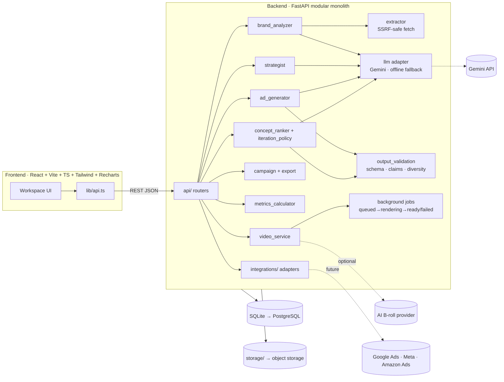
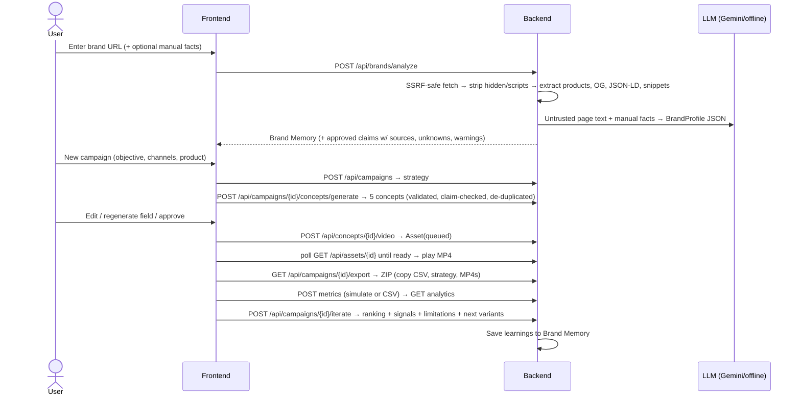

# AdPilot AI

**The AI marketing team for Indian D2C brands and SMEs.**
AdPilot AI learns a brand once, then plans, creates, launches and improves its campaigns, and every claim it makes is grounded in the brand's own product facts.

> HackCBS 9.0 · 24-hour build · Team of 2
> **Status (Sat 31 Oct, 14:10 IST):** G1 backend done. Website → Brand Memory → strategy → 5 claim-checked ad concepts works end to end through the API (offline mode tested; Gemini path ready). **Meko integration live** (verified against the real Meko server). Next: MP4 video renderer (G2), then analytics + optimization loop (G3).

### Progress at a glance
| Area | State |
|---|---|
| Website extraction (JSON-LD, Open Graph, Shopify feed, SSRF guard, hidden-text stripping) | ✅ Done |
| Brand Memory (claim grounding, audience hypotheses, unknowns, brand colours) | ✅ Done |
| Strategist (6 objectives) · Ad generator (5 concepts) · Claim guard · Platform copy | ✅ Done |
| FastAPI app (14 endpoints) + tests (`pytest -q`, 4 passing) | ✅ Done |
| Frontend mock data from real API responses (`sample_data/fixtures/`) | ✅ Done |
| Meko shared agent memory (datapack per brand, memories, context search, conversation traces) | ✅ Live |
| MP4 video ad renderer + export ZIP | ⏳ G2, in progress |
| Metrics, ranking, next-variant optimization, learnings → Meko | ⏳ G3 |
| Frontend workspace | ⏳ Teammate's track |

---

## Table of contents
1. [Product vision](#1-product-vision)
2. [Who it's for](#2-who-its-for)
3. [The ecosystem: 8 modules](#3-the-ecosystem-8-modules)
4. [What the MVP actually ships](#4-what-the-mvp-actually-ships)
5. [System architecture](#5-system-architecture)
6. [Data model](#6-data-model)
7. [End-to-end workflow](#7-end-to-end-workflow)
8. [Video generation design](#8-video-generation-design)
9. [Optimization engine design](#9-optimization-engine-design)
10. [Trust, safety and honesty rules](#10-trust-safety-and-honesty-rules)
11. [Ad platform integrations](#11-ad-platform-integrations)
12. [Tech stack](#12-tech-stack)
13. [Repository layout](#13-repository-layout)
14. [API overview](#14-api-overview)
15. [Team, ownership and 24-hour plan](#15-team-ownership-and-24-hour-plan)
16. [Demo script](#16-demo-script)
17. [Risks and mitigations](#17-risks-and-mitigations)
18. [Long-term roadmap](#18-long-term-roadmap)
19. [Getting started](#19-getting-started)

---

## 1. Product vision

We are **not** building another AI ad generator. We are building a unified marketing ecosystem: one platform, one brand intelligence layer, many marketing capabilities, and a continuous feedback loop.

It brings the strategist, creative agency, copywriter, video editor, campaign manager and analyst into one workspace that shares the same memory of the brand.

```
            ┌──────────────────────────────────────────────┐
            │                BRAND MEMORY                  │
            │  products · audience · tone · visual identity │
            │  approved claims · claims to avoid · learnings│
            └───────▲───────────────┬──────────────────────┘
                    │ learnings     │ context for every generation
   ┌────────────────┴─┐  ┌──────────▼──────┐  ┌────────────────┐  ┌──────────────┐
   │ 8. Optimization  │◄─┤ 7. Analytics    │◄─┤ 5. Campaign    │◄─┤ 4. Creative  │
   │    Engine        │  │                 │  │    Manager     │  │    Studio    │
   └──────────────────┘  └─────────────────┘  └────────────────┘  └──────▲───────┘
                                                                         │
                         1. Brand Intelligence → 2. Market Intel → 3. Strategist
```

The loop is the product: **understand → plan → create → launch → measure → learn → create better.**

### Positioning statement
> For Indian D2C brands and SMEs that can't afford an agency, AdPilot AI is an AI marketing workspace that turns a website URL into a brand memory, campaign strategy, ready-to-post video ads and copy, and then learns from campaign results. Unlike generic AI writers, it never invents product claims, and it keeps improving from evidence instead of guesses.

### Why this is not "just an AI wrapper"
1. **Brand Memory with claim grounding.** Every claim is either *approved, with its source* or *unknown, please confirm*. Hidden text and prompt-injection attempts on websites are stripped and ignored.
2. **A closed experiment loop with honest statistics.** Metrics are calculated in Python, never by the LLM. We show confidence intervals and sample-size warnings. New variants change only one or two variables, and part of each batch is reserved for exploration.
3. **Real MP4 output that never shows a fake product.** The real product image is composited by code. AI may generate the scenery, never the product.
4. **Built for India.** Copy in English, Hindi and Hinglish. INR pricing. Awareness of the ASCI rules on misleading ads.

---

## 2. Who it's for

| Segment | Pain today | What AdPilot gives them |
|---|---|---|
| Small D2C brands (1–10 people, Shopify/Instagram-led) | No agency budget. Ads go stale fast and they need creative at volume. Can't tell what's working. | Strategy, copy and videos in minutes, plus a "what to test next" loop |
| SMEs and local businesses | No marketing skills in-house. Too many disconnected tools. | One guided workspace from URL to campaign |
| Freelancers and small agencies | Re-brief every client from scratch. Manual reporting. | Multi-brand workspaces with persistent Brand Memory per client |
| **Everyone** | Compliance risk from overclaiming | A claim guard that flags unsupported, medical or "#1" style claims |

---

## 3. The ecosystem: 8 modules

| # | Module | Responsibility | Talks to |
|---|---|---|---|
| 1 | **Brand Intelligence Engine** | URL and manual ingestion, product catalogue, tone, audience hypotheses, visual identity, approved claims and unknowns. Owns **Brand Memory**. | Everything reads it. Optimization writes learnings back. |
| 2 | Market & Competitor Intelligence | Public competitor pages, positioning comparison, keyword/content opportunities | Strategist |
| 3 | **AI Marketing Strategist** | Objective-aware plan: positioning, segments, pain points, themes, angles, channels, CTAs, content calendar | Creative Studio, Calendar |
| 4 | **AI Creative Studio** | Hooks, copy, headlines, captions, platform variants, **MP4 video ads**, (later) images and voiceover. Preview, edit, regenerate, approve. | Asset Library, Campaign Manager |
| 5 | **Campaign Management** | Campaign object, approval workflow, export, provider adapters for publishing | Integrations, Analytics |
| 6 | Content Calendar & Workspace | Schedule, drafts, approvals, templates | Campaign Manager |
| 7 | **Analytics & Performance** | Unified metrics with provenance (`simulated`, `imported_csv`, `api:<provider>`) | Optimization |
| 8 | **AI Optimization Engine** | Ranks concepts, explains signals, generates the next batch of controlled variants, writes learnings to Brand Memory | Creative Studio, Brand Memory |

Bold = part of the hackathon vertical slice.

---

## 4. What the MVP actually ships

| Priority | Feature | Status target |
|---|---|---|
| Must 1 | URL ingestion (Shopify `products.json` → JSON-LD → Open Graph → page text) **plus** manual fallback | Working |
| Must 2 | Brand profile (Brand Memory) **plus** structured, editable campaign strategy | Working |
| Must 3 | 5 distinct ad concepts: hook, primary text, headline, CTA, visual brief, platform copy (Instagram, Meta Ads, Google Ads) | Working |
| Must 4 | **Real MP4 video ad** (9:16, about 15 s) rendered by Python, Pillow and FFmpeg | Working |
| Must 5 | Campaign workspace: preview, edit, regenerate a field, approve or reject, download, export ZIP | Working |
| Must 6 | Analytics on **clearly labelled** simulated or CSV data, plus AI-generated next variants with reasons | Working |
| Stretch | Voiceover (TTS), AI background scenes, Hindi/Hinglish copy, 1:1 format, UTM builder, calendar view, image creatives | If time |
| Roadmap | Real Google/Meta/Amazon integrations, competitor intelligence, budget assistant, unified assistant | Shown as designed but not connected |

**Rule:** finishing one end-to-end workflow beats many half-built features. Nothing in the UI may say "published", "connected" or "live" unless it really is.

---

## 5. System architecture

**A modular monolith.** There is one FastAPI app, and each module is its own service package with clear boundaries, so any module can become its own service later.



### Design decisions
| Decision | Why |
|---|---|
| Modular monolith, not microservices | 2 people, 24 hours. Service boundaries live in code, not in infrastructure. |
| SQLite + SQLModel with JSON columns | Zero setup. The schema can change during the hackathon. `DATABASE_URL` switches to Postgres. |
| FastAPI `BackgroundTasks` for video jobs | No Redis or Celery needed. The job status lives in the `Asset` row. Can be swapped for a real queue later. |
| LLM behind an adapter + offline fallback | The demo never depends on an API being up. Every output records `generation_mode`. |
| Structured JSON + Pydantic validation + 1 retry | Reliable outputs that the UI can render and edit |
| Deterministic Python for all numbers | Auditable. LLMs don't do arithmetic here. |
| Provider adapters for ad platforms | The creative pipeline is never coupled to Google, Meta or Amazon access |

---

## 6. Data model

```
Brand ─┬─< Campaign ─┬─< Concept ─┬─< Asset (video/image)
       │             │            └─< MetricSnapshot
       │             └─< Iteration (each optimisation round)
       └─< Asset (logos / uploads)                AuditLog (any entity)
```

| Entity | Key fields |
|---|---|
| **Brand** (Brand Memory) | name, website, `profile` (BrandProfile JSON), `guardrails` (claims/words to avoid), `learnings` (what worked), `sources`, `warnings`, logo_path, generation_mode |
| **Campaign** | brand_id, name, objective (`awareness · traffic · leads · sales · engagement · launch`), channels, product_focus, `strategy` JSON, status (`draft · generated · approved · scheduled · published · failed`) |
| **Concept** | campaign_id, concept_type (`problem · demo · storytelling · offer · testimonial-style`), target_segment, angle, hook, primary_text, headline, cta, visual_brief, platform_copy, video_script, claim_sources, risk_flags, **parent_concept_id, changed_variables, is_exploration**, status (`generated · approved · rejected`), generation_mode, prompt_version |
| **Asset** | concept_id, kind (`video · image · upload`), fmt, path, status (`queued · rendering · ready · failed`), generation_mode (`template`, `template+ai_broll`, …), error |
| **MetricSnapshot** | concept_id, platform, day, impressions, clicks, conversions, spend, revenue, **source_type** (`simulated · imported_csv · api:<provider>`) |
| **Iteration** | objective_metric, insight_summary, ranking, selected_signals, limitations, data_sources |
| **AuditLog** | entity, entity_id, action (`approved`, `exported`, `generated`…), detail |

The source of truth is `backend/app/models.py`. Pydantic schemas are in `backend/app/schemas/`.

---

## 7. End-to-end workflow



---

## 8. Video generation design

**Decision: hybrid. The real product is composited by code; AI is optional and only makes the scenery.**

Fully AI-generated video warps packaging, garbles label text and can show a product that doesn't exist. For an ad product that is a trust failure. So:

| Layer | Source | Always available? |
|---|---|---|
| Real product image(s), logo | Extracted from site / uploaded | ✅ |
| Hook, benefits, price, CTA text | Approved concept + approved claims | ✅ |
| Animation (slow zoom, slide-ins, word-by-word text, transitions) | Pillow frame rendering → FFmpeg H.264 | ✅ |
| Background | Brand-colour animated gradient (**default**) or AI scene footage (stretch) | Gradient ✅ / AI optional |
| Voiceover + subtitles | TTS provider (stretch) | Optional |
| Music | A track the team has rights to (`MUSIC_PATH`) | Optional |

**15-second 9:16 reel (1080×1920, 30 fps):**

| Time | Beat | On screen |
|---|---|---|
| 0–3 s | Hook | Bold hook revealed word by word over the background |
| 3–7 s | Product | Real product slides in, slow zoom, soft shadow, product name |
| 7–11 s | Benefits | 2–3 **approved** claims pop in one at a time |
| 11–15 s | CTA | Logo, price (only if extracted), CTA button, URL |

Each asset stores `generation_mode` (`template` / `template+ai_broll` / `template+tts`), and the UI shows it. A known-good backup MP4 is kept in `sample_data/` for the demo.

---

## 9. Optimization engine design

There is no foundation-model training. It's an **LLM-powered workflow with a transparent, testable decision layer**.

1. **Metrics (Python only).** CTR = clicks/impressions, CPC = spend/clicks, CVR = conversions/clicks, CPA = spend/conversions, ROAS = revenue/spend. Any metric with a zero denominator is `null` (shown as "—"), never 0.
2. **Objective → primary metric.** sales/leads → CVR (ROAS if revenue exists). traffic/engagement/launch → CTR. awareness → CTR as a labelled proxy.
3. **Sample-size gate.** `insufficient data` / `early signal` / `directional`, based on impressions, clicks and conversions. Raw counts are always shown beside the rates.
4. **Uncertainty.** A Wilson 95% interval for each rate, plus a Beta-Binomial Monte Carlo **P(best)** per concept. A winner is only called when intervals separate.
5. **Next batch (4 variants by default).**
   - About 75% **exploit**: take the top 1–2 concepts and change **one or two** variables (hook, CTA, headline, layout, segment).
   - About 25% **explore**: an under-tested concept type or angle.
   - Each variant stores `parent_concept_id`, `changed_variables`, `rationale` and the metric snapshot it used.
6. **Learnings → Brand Memory.** For example: "Problem-led hooks out-performed demo hooks on CTR (early signal, simulated data)."
7. **Limitations are always returned.** Simulated data, correlation is not causation, small samples.
8. **Optional ML:** only once real labelled campaign data exists (split by campaign or time, compared against a baseline). Not before.

---

## 10. Trust, safety and honesty rules

- Never invent testimonials, certifications, discounts, customer counts, ratings or performance numbers. Unsupported facts go to `unknowns_to_confirm`.
- Testimonial-style concepts are labelled **dramatization**, or they use real, approved material.
- Scraped content is **untrusted**: hidden elements and scripts are removed, and the LLM is told to ignore instructions inside it.
- The **claim guard** flags medical or cure language, "clinically proven", "#1/best", "100%", "guaranteed", and numbers or discounts not in the source.
- **SSRF protection:** http(s) only, standard ports, every redirect hop re-validated, private IPs blocked, size and time limits.
- Uploads are checked for type and size.
- Secrets stay in `backend/.env` only, never in the frontend bundle or git.
- Simulated metrics are tagged in the **database and the UI**.
- **Nothing is published and no money is spent** without explicit user approval. The MVP only exports.
- The audit log records approvals, exports and generations.

---

## 11. Ad platform integrations

The provider-adapter interface is `connect · validate · prepare_campaign · publish (requires approval) · fetch_metrics`.

| Provider | MVP | Notes (re-check current docs before building) |
|---|---|---|
| **Export** (ZIP: copy CSV, strategy JSON, MP4s) | ✅ Working | Works with any platform via manual upload |
| **Simulated** metrics | ✅ Working | Always labelled `simulated` |
| **CSV import** | ✅ Working | `source_type = imported_csv` |
| Google Ads API | Designed, not connected | For **advertisers**. Needs an OAuth + developer token, and production access requires Google approval. **Not AdSense**, which is for publishers monetising sites. |
| Meta Marketing API | Designed, not connected | Needs a Meta app, a business ad account, and app review for advanced access |
| Amazon Ads API | Designed, not connected | Needs registration/approval with Amazon Ads; verify eligibility first |
| Instagram organic publishing | Designed, not connected | Needs a business/creator account linked to a Facebook Page + app permissions |

The Integrations page shows exactly these statuses.

### Meko (by Yugabyte): shared agent memory ✅ live
[Meko](https://mekodata.netlify.app/) is Yugabyte's memory and knowledge layer for AI agents, built on YugabyteDB. AdPilot uses it as the cloud side of Brand Memory, so its agents share what they know and learn.

| AdPilot agent | When | Meko tools used |
|---|---|---|
| `adpilot-brand-agent` | After a brand is analyzed or edited | `conversation_create` → `datapack_create` (one datapack per brand) → `conversation_add_message` (sync trace) → `memory_add` (products, approved claims, tone, unknowns) |
| `adpilot-creative-agent` | Before and after generating concepts | `conversation_create` → `context_search` (past learnings fed into the Gemini prompt) → `conversation_add_message` (what was generated and the plan it followed) |
| `adpilot-analyst-agent` | After optimization (G3) | `memory_add` (what worked, labelled with its data source) → `memory_promote` (shared with all agents) |

How it's built:
- `backend/app/services/meko_memory.py` speaks MCP's streamable-HTTP protocol directly with `httpx` (no SDK dependency, because the `mcp` package's client API changed between v1 and v2).
- `backend/app/services/meko_sync.py` runs the syncs as background jobs, so Meko never slows the UI. The result is stored in `brand.integrations.meko` (`status`, `datapack_id`, `conversations`, …).
- Every call has a timeout. If Meko is unreachable, the app continues on local Brand Memory and shows the error on the Integrations page.
- Differences from the public docs, found against the live server (Meko MCP 3.2.4, 42 tools): `conversation_id` is required by `datapack_create`, `memory_add`, `context_search` and `memory_promote`; `metadata` must be a JSON string; errors can arrive wrapped as `{"result": "<json>"}`.
- Verify any time: `python -m app.scripts.meko_check` (ends with `ALL CALLS OK`), or `POST /api/integrations/meko/test`.

---

## 12. Tech stack

| Layer | Choice |
|---|---|
| Frontend | React 18, Vite, TypeScript, Tailwind CSS, Recharts, React Router, TanStack Query (handles polling and cache) |
| Backend | Python 3.11+, FastAPI, Uvicorn, Pydantic v2, SQLModel |
| AI | Gemini API (structured JSON output) behind `services/llm.py`, plus a deterministic offline provider |
| Extraction | httpx, BeautifulSoup4 (Trafilatura optional) |
| Video | Pillow (frames), FFmpeg (H.264 MP4), bundled fonts (Poppins, Lora). Optional TTS and AI B-roll |
| Data/stats | Python stdlib + NumPy (Wilson CI, Beta-Binomial P(best)), pandas for CSV |
| DB / storage | SQLite → PostgreSQL; local `storage/` → object storage |
| Tests | pytest + FastAPI TestClient |
| Deploy | Vercel (frontend) + a Python host with FFmpeg (e.g. Render/Railway/Fly). **Run the demo locally as primary.** |

---

## 13. Repository layout

```
adpilot-ai/
├── README.md                    ← you are here
├── docs/
│   ├── API_CONTRACT.md          ← the handshake between frontend and backend (freeze at H1)
│   ├── PLAN_ML_BACKEND.md       ← Aryan: intelligence layer, video, backend
│   └── PLAN_FRONTEND.md         ← Teammate: UI/UX, demo storefront, pitch visuals
├── backend/
│   ├── .env.example
│   ├── requirements.txt
│   ├── app/
│   │   ├── main.py              ✅ FastAPI app, CORS, /files, /demo-store, routers, /api/health
│   │   ├── config.py  db.py  models.py  serializers.py   ✅
│   │   ├── api/                 ✅ common brands campaigns concepts assets integrations · ⏳ analytics
│   │   ├── schemas/             ✅ brand.py concept.py
│   │   ├── services/
│   │   │   ├── extractor.py         ✅ SSRF-safe fetch, JSON-LD/OG/Shopify parsing, hidden-text stripping
│   │   │   ├── llm.py               ✅ Gemini + offline fallback, JSON validation + 1 retry
│   │   │   ├── brand_analyzer.py    ✅ → BrandProfile with grounded claims
│   │   │   ├── strategist.py        ✅ → CampaignStrategy
│   │   │   ├── ad_generator.py      ✅ → 5 concepts + platform copy + video script
│   │   │   ├── output_validation.py ✅ claim guard, diversity, platform limits
│   │   │   ├── text_utils.py        ✅ similarity, trimming helpers
│   │   │   ├── meko_memory.py       ✅ Meko MCP client (memories, context search, traces)
│   │   │   ├── meko_sync.py         ✅ background Meko sync jobs
│   │   │   ├── video_service.py     ⏳ Pillow/FFmpeg renderer (G2)
│   │   │   ├── export_service.py    ⏳ ZIP export (G2)
│   │   │   ├── metrics_calculator.py  concept_ranker.py  iteration_policy.py   ⏳ (G3)
│   │   ├── scripts/             ✅ make_demo_images.py export_fixtures.py meko_check.py
│   │   └── assets/fonts/        ✅ Poppins, Lora (SIL Open Font License)
│   └── tests/                   ✅ conftest.py test_api_flow.py · ⏳ metrics / ranking / iteration tests
├── frontend/
│   └── src/  pages/ components/ lib/api.ts lib/types.ts mocks/
└── sample_data/
    ├── demo_store/              fictional Indian skincare storefront (offline-safe demo URL)
    ├── fixtures/                real backend responses for frontend mocks
    ├── sample_metrics.csv       CSV import example
    └── backup_video.mp4         known-good demo video
```

---

## 14. API overview

The full request/response shapes and TypeScript types are in **[docs/API_CONTRACT.md](docs/API_CONTRACT.md)**.

| Method | Path | Purpose |
|---|---|---|
| GET | `/api/health` | LLM provider in use, FFmpeg availability |
| POST | `/api/brands/analyze` | URL and/or manual facts → Brand Memory |
| GET / PATCH | `/api/brands`, `/api/brands/{id}` | List, read and edit Brand Memory |
| POST | `/api/brands/{id}/uploads` | Logo / product images |
| POST | `/api/campaigns` | Create a campaign and generate its strategy |
| GET | `/api/campaigns?brand_id=`, `/api/campaigns/{id}` | List / detail (concepts, assets, iterations) |
| PATCH | `/api/campaigns/{id}` | Edit strategy or status (approve) |
| POST | `/api/campaigns/{id}/concepts/generate` | 5 concepts |
| PATCH | `/api/concepts/{id}` | Edit copy, approve or reject |
| POST | `/api/concepts/{id}/regenerate` | Regenerate one field |
| POST | `/api/concepts/{id}/video` | Start a video render job (202) |
| GET | `/api/assets/{id}`, `/api/assets?brand_id=` | Job status / asset library |
| GET | `/api/campaigns/{id}/export` | ZIP download |
| POST | `/api/campaigns/{id}/metrics/simulate` | Seed labelled simulated metrics |
| POST | `/api/campaigns/{id}/metrics` | CSV upload |
| GET | `/api/campaigns/{id}/analytics` | Totals, per-concept, daily, data provenance |
| POST | `/api/campaigns/{id}/iterate` | Ranking, signals, limitations, next variants |
| GET | `/api/integrations` | Honest provider statuses (Meko status is live) |
| POST | `/api/integrations/meko/test` | Live round-trip to Meko: tool count + datapacks |
| GET | `/api/concepts/{id}` | One concept with its latest video |

Built so far: health, brands (analyze, list, get, patch, uploads), campaigns (create, list, get, patch), concepts (generate, get, patch, regenerate), assets (get, list), integrations (list, Meko test). The video, export, metrics, analytics and iterate endpoints arrive in G2–G3.

---

## 15. Team, ownership and 24-hour plan

| Person | Track | Detailed plan |
|---|---|---|
| **Aryan** | ML, intelligence layer and backend: extraction, LLM, prompts, validation, strategy, concepts, **video pipeline**, metrics, ranking, iteration, API, tests | [docs/PLAN_ML_BACKEND.md](docs/PLAN_ML_BACKEND.md) |
| **Teammate** | Frontend UI/UX: design system, all workspace screens, states and polling, charts, demo storefront page, pitch visuals | [docs/PLAN_FRONTEND.md](docs/PLAN_FRONTEND.md) |

**How the two tracks never block each other:** the API contract is frozen at H1. The frontend builds against mock fixtures (`VITE_USE_MOCKS=true`). Aryan replaces those mocks with **real** backend responses at each sync point.

**Clock:** started Sat 31 Oct 13:15 IST → **ends Sun 1 Nov 11:59 IST** (≈22 h 45 m). **Submit by 11:30**: never at the last minute.

| Time (IST) | Aryan (ML/Backend) | Teammate (Frontend) | Sync point |
|---|---|---|---|
| **Sat 13:15–14:00** | Contract walkthrough, `.env`, Gemini key test, FFmpeg check | Vite + Tailwind + router scaffold, design tokens | **🔒 Contract freeze 14:00** |
| 14:00–18:00 | LLM adapter, brand analyzer, strategist, concept generator + claim guard | App shell, component kit, Onboarding, Brand Workspace, Strategist (mocks) | — |
| **18:00** | Real fixtures for brand/strategy/concepts | Switch those screens to the live API | **🔁 Sync 1** |
| 18:00–23:00 | Video pipeline + jobs, edit/approve/regenerate, export ZIP, backup MP4 | Creative Studio (video, polling, editing), Campaign Manager | 🍽️ dinner ~20:30 (30 min) |
| **23:00** | Video endpoint live | Creative Studio live | **🔁 Sync 2: first full demo run** |
| Sun 23:00–03:00 | Metrics, ranker, iteration policy, analytics, learnings → memory | Analytics + Optimize, Integrations, Asset Library | — |
| **03:00** | Analytics/iterate live | Analytics live | **🔁 Sync 3** |
| 03:00–06:00 | ONE stretch goal (TTS voiceover or Hindi/Hinglish) + rest 04:30–06:00 | Overview, calendar, demo store polish + rest 03:00–04:30 | — |
| **06:00** | | | **🧊 Feature freeze** |
| 06:00–09:00 | Tests, eval scorecard, fallbacks, `reset_demo` | Bug bash, empty/error states, projector check | — |
| 09:00–10:30 | Demo DB snapshot, backup MP4, architecture slide | Pitch deck, 2–3 min demo video recording | — |
| 10:30–11:30 | Rehearse ×2, push final code, README check | Rehearse ×2, submission form | **📤 Submit by 11:30** |

Rests are staggered so one person is always awake to keep things moving. Commit small and often to `main`, with feature branches only for risky work.

> ⚠️ Check the HackCBS 9.0 rules on pre-written code. If code must be written during the event, treat this repo's early scaffold as planning material and re-create it on site, or declare it to the organisers.

---

## 16. Demo script (≈4 minutes)

Demo brand: **Velvaa Skin**, a *fictional* Indian skincare brand served from `sample_data/demo_store` at `https://demo.adpilot.local/` (no internet needed).

1. **Brand Workspace:** paste the URL → Brand Memory appears. Point out approved claims with sources, unknowns to confirm, and the warning *"Ignored 1 hidden element"* (the hidden prompt-injection on the page).
2. **Strategist:** create a "Sales" campaign → positioning, segments, angles, channel plan, 7-day calendar.
3. **Creative Studio:** 5 distinct concepts, platform-specific copy, a risk flag on the testimonial-style concept.
4. Click **Generate video** → about 20 s → play the real MP4 (labelled `template`).
5. Edit a headline, regenerate a hook, **approve** 3 concepts → campaign moves to *Approved* → **Export ZIP**.
6. **Analytics:** load simulated data → the big **SIMULATED** banner → per-concept CVR with intervals and sample warnings.
7. **Optimize:** next 4 variants, each with "changed: hook — because…", one marked *exploration*, and the limitations listed.
8. Back in **Brand Memory**, the learnings now appear there. Close on the ecosystem slide.

Have ready: the backup MP4, a pre-seeded database (`scripts/reset_demo`), and a screen recording.

---

## 17. Risks and mitigations

| Risk | Mitigation |
|---|---|
| LLM slow, down or invalid JSON | Pydantic validation, 1 retry, offline provider, timeouts, cached demo brand |
| Video looks cheap or renders slowly | Pre-rendered static layers, quick preview first, strong motion design, backup MP4 |
| Site blocks scraping or needs JavaScript | Shopify JSON → JSON-LD → Open Graph → text → manual. Bundled demo store. |
| Wi-Fi at venue | Everything runs locally. Offline LLM mode. Demo store needs no internet. |
| Integration overreach | Export + adapter design. Honest status page. |
| Scope creep | H18 feature freeze. Stretch goals only after Sync 3. |

---

## 18. Long-term roadmap

1. Brand Safety & Compliance Checker as a full module (platform policy packs, ASCI rules)
2. Localization engine (Hindi, Hinglish, Tamil, Bengali; regional voiceover)
3. UTM & attribution assistant
4. Unified marketing assistant (chat over the shared brand and campaign data)
5. Content calendar with scheduling, plus team roles
6. Reusable templates by category, objective and platform
7. Real Meta / Google Ads connectors (OAuth, approval-gated publishing, reporting)
8. Market & competitor intelligence
9. Budget assistant (bounded by user budgets, approval required)
10. Contextual bandits / learned ranking once real data exists

---

## 19. Getting started

```bash
# backend
cd backend
python -m venv .venv && source .venv/bin/activate   # Windows: .venv\Scripts\activate
pip install -r requirements.txt
cp .env.example .env            # Windows: copy .env.example .env
#   GEMINI_API_KEY=...  optional; offline mode works without it
#   MEKO_API_KEY=...    from cloud.mekodata.ai → Settings → API Keys
ffmpeg -version                 # must be installed and on PATH (Windows: winget install Gyan.FFmpeg)
pytest -q                       # 4 passed
python -m app.scripts.meko_check   # ends with ALL CALLS OK when Meko is configured
uvicorn app.main:app --reload --port 8000

# frontend
cd frontend
npm install
cp .env.example .env            # VITE_API_URL=http://localhost:8000, VITE_USE_MOCKS=false
npm run dev                     # http://localhost:5173
```

API docs are auto-generated at `http://localhost:8000/docs`.

**Try it in 30 seconds:** open `/docs` → `POST /api/brands/analyze` with `{"url": "https://demo.adpilot.local/"}` → `POST /api/campaigns` with `{"brand_id": 1, "objective": "sales"}` → `POST /api/campaigns/1/concepts/generate`. A few seconds after analyzing, `GET /api/brands/1` shows `integrations.meko.status = "synced"`.

> If you pulled a newer version and the server errors with "no such column", delete `backend/adpilot.db`; it is recreated on start (the schema is still changing during the hackathon).

**Frontend without the backend:** set `VITE_USE_MOCKS=true` and read the JSON files in `sample_data/fixtures/` (real API responses).
